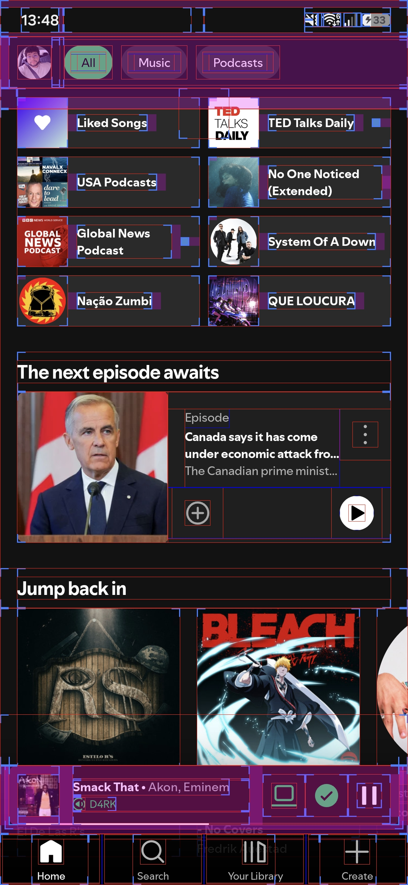
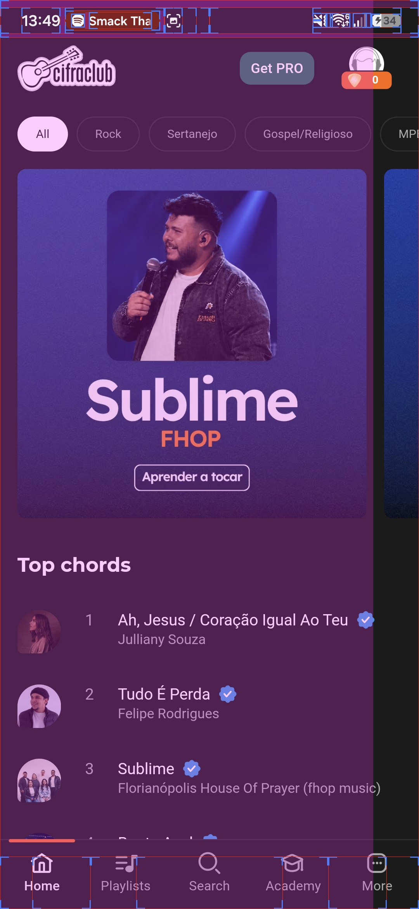
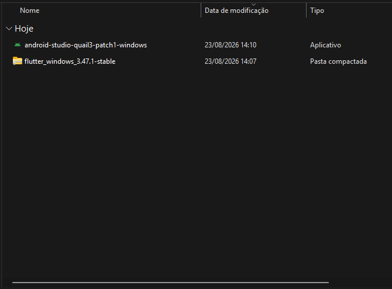
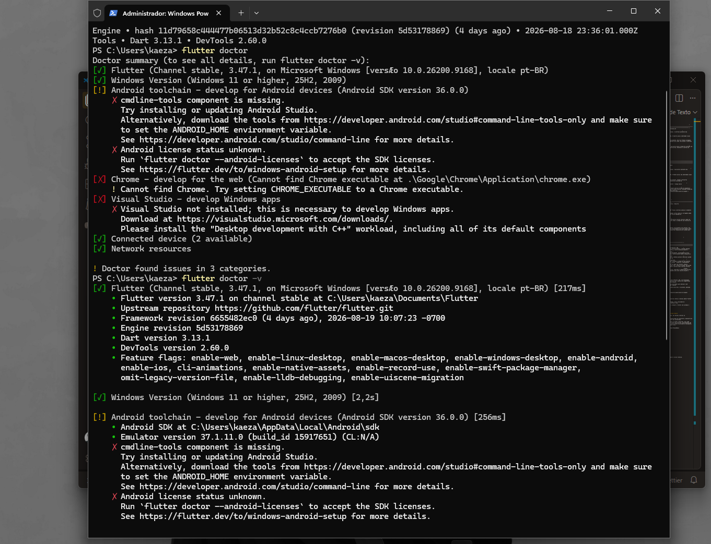

## Parte A — Análise de apps reais

## App 1 – Spotify

| Item                                               | Resposta                                                                                                                                                                                       |
| -------------------------------------------------- | ---------------------------------------------------------------------------------------------------------------------------------------------------------------------------------------------- |
| Categoria                                          | Streaming de música                                                                                                                                                                            |
| A rolagem é fluida ou engasga?                     | Fluida. A interface apresenta boa responsividade e poucas travadas durante o uso.                                                                                                              |
| A aparência é igual à de outros apps do Android?   | Não. O Spotify possui identidade visual própria e uma interface personalizada.                                                                                                                 |
| Funciona em modo avião? O que ainda dá para fazer? | Parcialmente. Usuários Premium conseguem reproduzir músicas baixadas. Algumas informações podem aparecer por cache, mas buscas e conteúdos online deixam de funcionar.                         |
| Abordagem que eu chuto                             | Nativo                                                                                                                                                                                         |
| Evidência do meu chute                             |  |

---

## App 2 – Nubank

| Item                                               | Resposta                                                                                                                                                                                                                                                                                                   |
| -------------------------------------------------- | ---------------------------------------------------------------------------------------------------------------------------------------------------------------------------------------------------------------------------------------------------------------------------------------------------------- |
| Categoria                                          | Banco digital                                                                                                                                                                                                                                                                                              |
| A rolagem é fluida ou engasga?                     | Fluida. O aplicativo apresenta boa performance e animações suaves.                                                                                                                                                                                                                                         |
| A aparência é igual à de outros apps do Android?   | Não. O Nubank possui uma identidade visual própria e uma experiência semelhante entre Android e iOS.                                                                                                                                                                                                       |
| Funciona em modo avião? O que ainda dá para fazer? | Parcialmente. Algumas informações carregadas anteriormente podem aparecer, mas operações financeiras precisam de internet.                                                                                                                                                                                 |
| Abordagem que eu chuto                             | Flutter + código nativo (híbrido)                                                                                                                                                                                                                                                                          |
| Evidência do meu chute                             | O Nubank publicou artigos de engenharia informando o uso do Flutter para acelerar o desenvolvimento de novos recursos, mantendo integração com código nativo existente. Fonte: https://building.nubank.com/pt-br/por-que-achamos-que-o-flutter-vai-nos-ajudar-a-escalar-o-desenvolvimento-movel-no-nubank/ |

---

## App 3 – Cifra Club

| Item                                               | Resposta                                                                                                                                                     |
| -------------------------------------------------- | ------------------------------------------------------------------------------------------------------------------------------------------------------------ |
| Categoria                                          | Música / Educação musical                                                                                                                                    |
| A rolagem é fluida ou engasga?                     | Fluida.                                                                                                                                                      |
| A aparência é igual à de outros apps do Android?   | Não. Possui interface própria e elementos personalizados.                                                                                                    |
| Funciona em modo avião? O que ainda dá para fazer? | Algumas cifras salvas ou carregadas podem continuar disponíveis, porém pesquisas, vídeos e conteúdos online dependem de conexão.                             |
| Abordagem que eu chuto                             | Nativo                                                                                                                                                       |
| Evidência do meu chute                             | |

---

### Teste do modo avião

Dos três aplicativos analisados, o Spotify apresentou o melhor funcionamento sem internet. Ele consegue continuar reproduzindo músicas baixadas e utiliza armazenamento local para manter parte da experiência disponível. Já o Nubank e o Cifra Club possuem mais dependência da conexão para acessar suas principais funcionalidades.

---

# Parte B — Escolhendo a abordagem

| Cenário                                                                        | Abordagem      | Justificativa                                                                                                                                                                                                                        |
| ------------------------------------------------------------------------------ | -------------- | ------------------------------------------------------------------------------------------------------------------------------------------------------------------------------------------------------------------------------------ |
| Startup com 2 devs, 3 meses de prazo, precisa lançar em Android e iOS          | Flutter        | Com uma equipe pequena e pouco tempo para desenvolvimento, o Flutter permite criar uma única base de código para Android e iOS. Isso reduz o custo de desenvolvimento e facilita a manutenção a longo prazo.                         |
| App de edição de vídeo com filtros aplicados em tempo real                     | Nativo         | Aplicações de edição de vídeo exigem alto desempenho, processamento gráfico intenso e acesso eficiente à câmera e GPU. O desenvolvimento nativo permite melhor otimização e integração com recursos específicos do sistema.          |
| Portal de notícias de um jornal que já tem site responsivo                     | WebView        | Como o jornal já possui um site responsivo, a WebView permite reutilizar grande parte da estrutura existente. Isso reduz o tempo e o custo de desenvolvimento.                                                                       |
| App bancário com biometria e certificado armazenado no aparelho                | Nativo         | Aplicativos bancários precisam de segurança elevada e integração com recursos protegidos do sistema. O desenvolvimento nativo facilita o acesso à biometria, armazenamento seguro e APIs específicas da plataforma.                  |
| App interno de uma empresa, só Android, 200 funcionários em campo sem internet | Nativo Android | Como o aplicativo será utilizado apenas em Android, não é necessário manter uma versão para outra plataforma. O desenvolvimento nativo oferece maior controle sobre recursos offline, armazenamento local e hardware do dispositivo. |
| Jogo 2D casual com física e placar online                                      | Unity/Godot    | Jogos possuem necessidades específicas como física, animações e renderização gráfica. Engines como Unity ou Godot oferecem ferramentas mais adequadas para esse tipo de projeto e facilitam a criação para múltiplas plataformas.    |

---

# Parte C — Pesquisa: migrações reais

## Caso 1 — Nubank migrando para Flutter

O Nubank utilizava inicialmente desenvolvimento separado para Android e iOS, com tecnologias nativas. A empresa começou a adotar Flutter para novos recursos com o objetivo de compartilhar código entre plataformas e aumentar a velocidade de desenvolvimento.

O ganho principal foi permitir que equipes entregassem funcionalidades para Android e iOS utilizando uma base compartilhada, reduzindo duplicação de trabalho.

A principal dificuldade foi integrar o Flutter com uma grande aplicação já existente, mantendo partes do código nativo.

Fonte:
https://building.nubank.com/pt-br/por-que-achamos-que-o-flutter-vai-nos-ajudar-a-escalar-o-desenvolvimento-movel-no-nubank/

---

## Caso 2 — BMW migrando para Flutter

A BMW utilizava diferentes soluções para desenvolver aplicativos móveis e decidiu adotar Flutter para padronizar o desenvolvimento entre plataformas.

A empresa relatou ganhos relacionados à reutilização de código, maior velocidade de desenvolvimento e uma experiência mais consistente entre Android e iOS.

A dificuldade principal foi adaptar processos existentes e integrar o Flutter com sistemas e componentes nativos.

Fonte:
https://flutter.dev/showcase/bmw

---

## Caso que abandonou uma stack cross-platform — Airbnb e React Native

A Airbnb utilizou React Native em parte de seus aplicativos, mas decidiu retornar ao desenvolvimento nativo.

As principais razões foram problemas de escalabilidade, complexidade da arquitetura, manutenção do código e dificuldades de integração com recursos específicos das plataformas.

Esses problemas não significam que Flutter possui exatamente as mesmas limitações, pois cada framework possui uma arquitetura diferente. Porém, o caso mostra que soluções cross-platform não são ideais para todos os projetos, principalmente quando existe grande necessidade de desempenho, controle profundo do sistema e integração com recursos específicos.

Fonte:
https://medium.com/airbnb-engineering/react-native-at-airbnb-f95aa460be1c

---

# Parte D — Preparação do ambiente

## D1 — Ferramentas instaladas

* Flutter SDK 3.35 stable
* Android Studio
* VS Code com extensão Flutter

Print:


---

## D2 — Espaço disponível em disco

Espaço livre confirmado no computador.

Print:


---

## D3 — Depuração USB

Opções de desenvolvedor ativadas e Depuração USB habilitada no celular Android.

Print:


---

# Bônus — Flutter Doctor

Caso realizado:

```bash
flutter doctor -v
```

Print:

