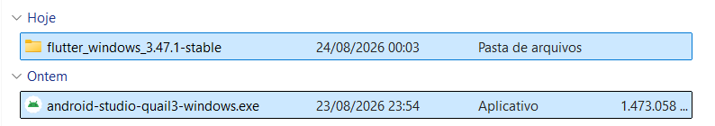

# ---- Ativade PARTE A ----- #

### App: Nubank

| Item | Resposta |
|---|---|
| Categoria | Banco |
| A rolagem é fluida ou engasga? | Extremamente fluida, sem engasgos ou travamentos ao deslizar pelo feed de atividades. |
| A aparência é igual à de outros apps do Android? | Não. Ele possui uma identidade visual altamente customizada, botões arredondados e cores que não seguem os padrões nativos do Android. |
| Funciona em modo avião? O que ainda dá para fazer? | Sim. É possível acessar o aplicativo e navegar pelos dados armazenados em cache, como o saldo oculto e o histórico de faturas passadas. |
| Abordagem que eu **chuto** | Flutter |
| Evidência do meu chute | Ao usar a opção "Mostrar limites de layout" do Android, os limites não contornam cada pequeno texto ou ícone individualmente como no nativo, exibindo a tela como um grande bloco desenhado de forma independente. |

---

### App: WhatsApp

| Item | Resposta |
|---|---|
| Categoria | Mensagens / Rede Social |
| A rolagem é fluida ou engasga? | Muito fluida, mesmo ao percorrer listas imensas de contatos ou históricos de conversas com muitas mídias. |
| A aparência é igual à de outros apps do Android? | Sim. O aplicativo respeita a interface nativa do Android (ou iOS), utilizando as caixas de diálogo, animações e menus padrão do sistema operacional. |
| Funciona em modo avião? O que ainda dá para fazer? | Sim. Você pode ler todas as mensagens já recebidas, ver fotos que já foram baixadas e até escrever e enviar novas mensagens (elas ficam com o ícone de relógio e disparam assim que a internet voltar). |
| Abordagem que eu **chuto** | nativo |
| Evidência do meu chute | A opção "Mostrar limites de layout" revela caixas ao redor de absolutamente todo componente (cada avatar, linha de texto e ícone de check tem seu próprio limite). É o comportamento clássico de elementos nativos do Android (Views). |

---

### App: iFood

| Item | Resposta |
|---|---|
| Categoria | Delivery |
| A rolagem é fluida ou engasga? | Fluida na maior parte da navegação, mas pode apresentar leves "engasgos" ou pequenos delays ao carregar as vitrines de imagens dos restaurantes. |
| A aparência é igual à de outros apps do Android? | É um meio-termo. Ele possui identidade muito forte (botões vermelhos, fontes próprias), mas ainda usa alguns elementos de navegação (como o comportamento do teclado e barras) do sistema. |
| Funciona em modo avião? O que ainda dá para fazer? | Parcialmente. Ele abre usando dados em cache mostrando a última tela inicial carregada, mas se você tentar entrar em um restaurante ou concluir pedido, será bloqueado. |
| Abordagem que eu **chuto** | React Native |
| Evidência do meu chute | O app tem performance próxima ao nativo, mas com sutis particularidades em animações de transição que indicam uso de um framework multiplataforma. Como o iFood é famoso por usar React Native em sua estrutura, este é o palpite mais adequado. |

### ---- Atividade PARTE B ---- ###

### Cenário 1: Startup com 2 devs, 3 meses de prazo, precisa lançar em Android e iOS
* **Abordagem Escolhida:** Flutter
* **Justificativa:** O desenvolvimento multiplataforma permite que uma equipe pequena escreva um único código para lançar simultaneamente no Android e iOS dentro de um prazo restrito. Isso otimiza os limitados recursos da startup sem sacrificar a qualidade visual do produto final.

---

### Cenário 2: App de edição de vídeo com filtros em tempo real
* **Abordagem Escolhida:** Nativo
* **Justificativa:** A edição de vídeo com renderização ao vivo exige processamento intenso e comunicação direta de baixo nível com a GPU e a câmera do dispositivo. Utilizar a tecnologia nativa elimina o "pedágio" de performance cobrado por camadas intermediárias, garantindo a fluidez máxima sem travamentos.

---

### Cenário 3: Portal de notícias de um jornal que já tem site responsivo
* **Abordagem Escolhida:** WebView
* **Justificativa:** Como a empresa já dispõe de um site adaptável e o consumo de notícias baseia-se na leitura de mídia estática, envelopar essa versão web reduz drasticamente os custos do projeto. Não há necessidade técnica ou de negócio para investir no desenvolvimento de uma interface gráfica complexa do zero.

---

### Cenário 4: App bancário com leitor de biometria e certificado no aparelho
* **Abordagem Escolhida:** Nativo
* **Justificativa:** Transações financeiras demandam altíssimos padrões de segurança e acesso profundo aos módulos de criptografia de hardware do celular (como o Secure Enclave ou Keystore). O desenvolvimento nativo reduz a dependência de bibliotecas de terceiros, minimizando vulnerabilidades e garantindo acesso imediato às atualizações de segurança dos fabricantes.

---

### Cenário 5: App interno de uma empresa, só Android, 200 funcionários, usado em campo sem internet
* **Abordagem Escolhida:** Nativo
* **Justificativa:** Como o aplicativo tem como alvo apenas uma plataforma, o principal benefício de economia de tempo das ferramentas híbridas desaparece, tornando a construção nativa mais lógica. Além disso, as linguagens nativas oferecem controle superior sobre bancos de dados locais e serviços em segundo plano, requisitos absolutos para o funcionamento offline estável.

---

### Cenário 6: Jogo 2D casual com física e placar online
* **Abordagem Escolhida:** Flutter
* **Justificativa:** O framework gerencia o desenho da tela pixel por pixel e possui excelente suporte a motores dedicados para jogos casuais (como a biblioteca Flame). Essa característica entrega altas taxas de atualização para a física do jogo, mantendo a grande vantagem de exportar o título para várias plataformas com o mesmo esforço.

### ---- PARTE C ---- ###

### 1. Caso Nubank (Fintech)
* **Stack anterior e motivo:** Utilizavam uma arquitetura mista de nativo (Swift, Objective-C, Java, Kotlin) e React Native; migraram para unificar as equipes em uma única linguagem, melhorar a experiência do desenvolvedor e eliminar bugs específicos de cada sistema operacional.
* **Ganho mensurável:** O tempo médio para aprovação de código (merge de PRs) caiu para 9,9 minutos (contra uma média histórica de 70,45 min no nativo) e o produto de Seguro de Vida foi lançado em apenas 3 meses, processo que antes levaria até um ano.
* **Dificuldade na migração:** A equipe subestimou o tamanho do projeto; o app precisou conviver em um estado "Frankenstein" (misturando telas nativas e em Flutter) por muito tempo, exigindo a criação de ferramentas internas complexas e retreinamento de todos os times.
* **Fonte:** building.nubank.com/scaling-with-flutter.

---

### 2. Caso BMW (Automobilística)
* **Stack anterior e motivo:** Mantinham diversos aplicativos com bases de código separadas para iOS e Android em diferentes mercados; migraram porque essa fragmentação causava atrasos nas atualizações e inconsistência na experiência global da marca.
* **Ganho mensurável:** A equipe relatou uma entrega de novas funcionalidades 40% mais rápida em comparação com a abordagem nativa anterior, conseguindo unificar as operações para usuários de mais de 45 países sob uma única base de código (o app MyBMW).
* **Dificuldade na migração:** O modelo baseado em árvore de widgets do Flutter quebrou os fluxos tradicionais de testes automatizados da empresa, forçando-os a investir tempo desenvolvendo uma infraestrutura pesada e customizada para conseguir testar a interface de suas centenas de telas.
* **Fonte:** https://arxiv.org/html/2510.18861v1

### PARTE D ###

### Não tenho Android