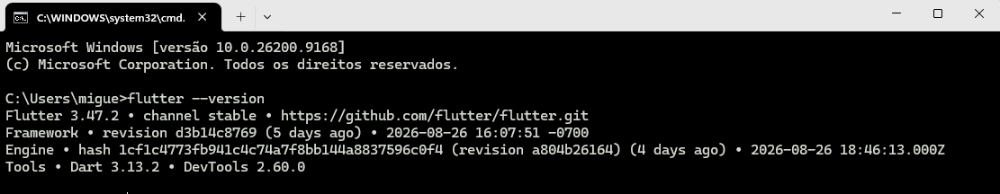
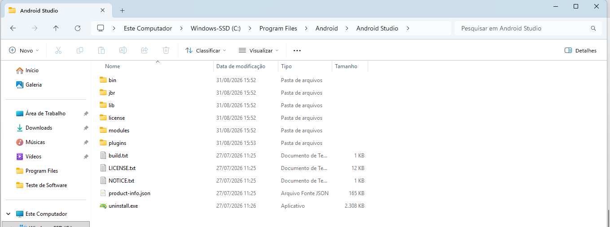
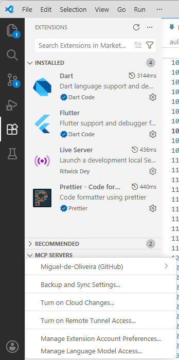
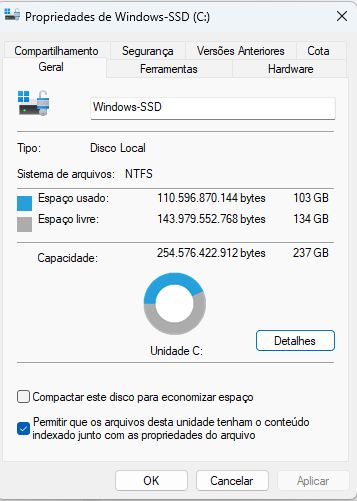
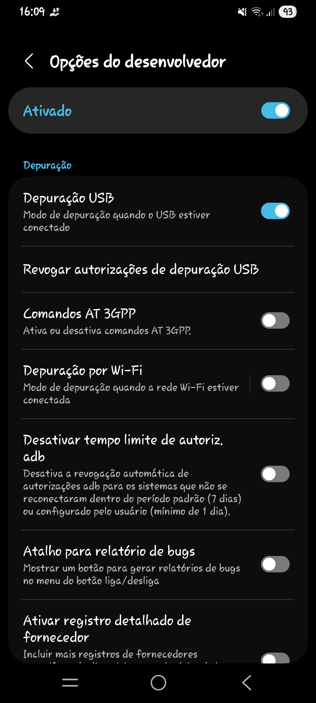
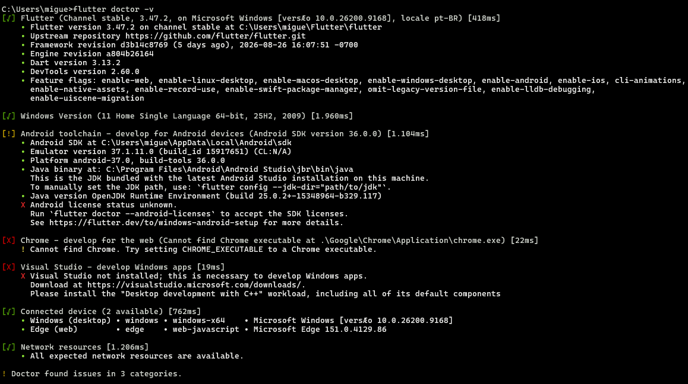

# Exercício — Aula 01: O Ecossistema Mobile e o Lugar do Flutter

**Disciplina:** Desenvolvimento Mobile (`F105880`) — UNIT 2026
**Professor :** Petros Barreto
**Aluno     :** Miguel Luiz Lins de Oliveira

---

## Parte A — Análise de apps reais (30 pontos)

### App: <WhatsApp>

| Item | Resposta |
|---|---|
| Categoria | rede social |
| A rolagem é fluida ou engasga? | Fluída |
| A aparência é igual à de outros apps do Android? | Similar ao Youtube e um pouco diferente ao do PicPay |
| Funciona em modo avião? O que ainda dá para fazer? | Para enviar mensagens, ligar e carregar mídias precisa de internet. A função principal do zap deixa o usuário na mão quando sem internet. |
| Abordagem que eu **chuto** | Nativo e React Native |
| Evidência do meu chute | [Arquitetura do WhatsApp](https://dev.to/nube_colectiva_nc/the-architecture-of-ubiquity-what-is-whatsapp-made-of-e3) |

### App: <YouTube>

| Item | Resposta |
|---|---|
| Categoria | entretenimento / rede social |
| A rolagem é fluida ou engasga? | Fluida. |
| A aparência é igual à de outros apps do Android? | Diferente, mas o comportamento é diferente comparado ao PicPay e WhatsApp. |
| Funciona em modo avião? O que ainda dá para fazer? | Não dá para fazer nada, fica carregando infinitamente. |
| Abordagem que eu **chuto** | nativo |
| Evidência do meu chute | [App Brain](https://www.appbrain.com/stats/libraries/details/kotlin/kotlin#) |

### App: <PicPay>

| Item | Resposta |
|---|---|
| Categoria | banco |
| A rolagem é fluida ou engasga? | Fluida. |
| A aparência é igual à de outros apps do Android? | É diferent. |
| Funciona em modo avião? O que ainda dá para fazer? | Não dá para fazer nada, fica carregando infinitamente. |
| Abordagem que eu **chuto** | Nativa |
| Evidência do meu chute | [UDS Tecnologia](https://uds.com.br/blog/picpay-app-tecnologias-no-desenvolvimento/) |

---

## Parte B — Escolhendo a abordagem (30 pontos)

Para cada cenário, escolha **uma** abordagem e **justifique em 2 a 4 frases**.
Não existe resposta única — existe justificativa boa e ruim.

| # | Cenário | Pts | Justificativa |
|---|---|---|---|
| B1 | Startup com 2 devs, 3 meses de prazo, precisa lançar em Android e iOS | 5 | Como o prazo é curto e a quantidade de devs é pouca, o ideal seria usar a abordagem WebView porque se já existir a aplicação web responsiva, pode reaproveitar pra empacotar para mobile. Porém, se for iniciar do zero, para que não tenha trabalho de criar duas bases de código(kotlin e swift)(manutenção num código só) e que o design tem que ser igual nos dois SO, o ideal é ser o Flutter. |
| B2 | App de edição de vídeo com filtros aplicados em tempo real | 5 | O app precisa ter um desempenho excelente para que o filtro funcione da melhor forma e quando receber atualizações de SO para melhorar os recursos, então usaria a abordagem Nativa. O ponto negativo é ter que sustentar duas bases de código, levando mais tempo de manutenção.  |
| B3 | Portal de notícias de um jornal que já tem site responsivo | 5 | Como já tem site responsivo, pode empacotá-lo para app mobile, ou seja, abordagem WebView. A manutenção sai barata pois é feita pelo servidor. |
| B4 | App bancário com biometria e certificado armazenado no aparelho | 5 | Abordagem Nativa, pois quando o SO precisa ser atualizado por questões de segurança o app consegue acompanhar essa atualização, além de que usar recursos nativos deixam o app mais leve e com acesso direto(o leitor biométrico, exemplo). Porém, o custo de manutenção é altíssimo, não só manter 2 bases de código como também app bancário precisa passar por um rigoroso teste antes de ir à produção levando mais tempo comparado aos apps que não envolvem dados sensíveis e com poucos usuários. |
| B5 | App interno de uma empresa, só Android, 200 funcionários em campo sem internet | 5 | Abordagem Nativa(Kotlin), manutenção mais barata por ter o foco em um SO,  usa com o máximo de desempenho do recurso nativo e com profissionais especializados. |
| B6 | Jogo 2D casual com física e placar online | 5 | Abordagem Nativa com framework de games(ex: Unity) ou o Flutter; ao usar o framework de games já tem recursos de física e quando o SO atualiza, o Flutter e framework de games não quebram. |

---

## Parte C — Pesquisa: migrações reais (20 pontos)

**C1: Supercell**

- A empresa usava iOS, Android e macOS, porém o motivo da migração foi porque manter bases de código separadas era ineficiente e não era compatível com as compilações de desenvolvimento de desktop    ;
- Aprenderam o flutter rapidamente e cerca de 1 ano conseguiram montar o SDK para relançamento os apps da empresa. O flutter trouxe a funcionalidade de compilações para desktop e ajudou a reduzir o código principal do Supercell ID em 45%;
- Como aprendizado com o flutter foi rápido, parece que não tiveram dificuldades;
- **fonte**: https://flutter.dev/showcase/supercell

 
**C1: Google Classroom**

- Usavam Nativo(Kotlin e Swift), migraram por causa do alto volume de codificação gerando sobrecarga, principalmente, para manter o sistemas para dois SO. Então, como a equipe de GPay estava indo bem com flutter, decidiram migrar;
- 98% do código mobile é compartilhado, tamanho do código reduzido para 66% com as mesmas funcionalidades, recarga automática reduzindo o tempo da build incremental de minutos para segundos;
- A equipe migrou pro flutter para o IOS primeiro, e depois de 6 meses, seguiram com o Android. No geral, acharam o Flutter mais fácil;
- **fonte**: https://flutter.dev/showcase/google-classroom

**C2: Airbnb**

- Desafios técnicos e organizacionais gerados pela abordagem híbrida, manter IOS, Android e React Native. Pois tinha que manter a infraestrutura de pontes/integração do RN gastando muito esforço pra algo que poderia ser "simples", também sofria de lentidão de inicialização, as atualização do RN quebravam as bibliotecas, dificuldades em depurar problemas de js e RN e animações difíceis de fazer e manter. 
- Sim, porque os engenheiros teriam que conciliar flutter/dart junto com o nativo, o que causaria um atrito cultural na empresa e demandaria um esforço grande para manter as ferramentas.
- Não usar quando o sistema nativo já possui complexidade, maturidade e que é funcional, porque adicionar cross-platform geraria débito técnico e reinventaria a roda. Também não usar quando a empresa tem um time grande e especializados(aprender uma stack leva tempo), além de que quando o sistema precisa de mais recurso e melhor performance, é preferível o nativo.

---

## Parte D — Preparação do ambiente (20 pontos)

Esta parte é o que faz a Aula 02 render. Faça **antes** da aula.

**D1 (10 pts).** Baixe (não precisa instalar ainda, instalamos juntos):

- [√] Flutter SDK **3.35 stable** — <https://docs.flutter.dev/get-started/install>
- [√] Android Studio — <https://developer.android.com/studio>
- [√] VS Code + extensão **Flutter** — <https://code.visualstudio.com>

Entregue: 

- Flutter:  
- Android Studio: 
- VS Code + extensão: 

**D2 (5 pts).** Confirme que tem **20 GB livres** em disco e entregue o print:

**D3 (5 pts).** Se você tem um celular Android, ative as opções de
desenvolvedor e entregue o print da tela com a **Depuração USB** ligada:

### 🎁 Bônus (+10 pontos)

- Flutter doctor: 

[!] Android toolchain - develop for Android devices (Android SDK version 36.0.0) [1.104ms]
    • Android SDK at C:\Users\migue\AppData\Local\Android\sdk
    • Emulator version 37.1.11.0 (build_id 15917651) (CL:N/A)
    • Platform android-37.0, build-tools 36.0.0
    • Java binary at: C:\Program Files\Android\Android Studio\jbr\bin\java
      This is the JDK bundled with the latest Android Studio installation on this machine.
      To manually set the JDK path, use: `flutter config --jdk-dir="path/to/jdk"`.
    • Java version OpenJDK Runtime Environment (build 25.0.2+-15348964-b329.117)
    X Android license status unknown.
      Run `flutter doctor --android-licenses` to accept the SDK licenses.
      See https://flutter.dev/to/windows-android-setup for more details.

**R:** *O Android lincences foi descontinuado para a nova versão(37)*

[X] Chrome - develop for the web (Cannot find Chrome executable at .\Google\Chrome\Application\chrome.exe) [22ms]
    ! Cannot find Chrome. Try setting CHROME_EXECUTABLE to a Chrome executable.

**R:** *Não tenho o navegador Chrome.*

[X] Visual Studio - develop Windows apps [19ms]
    X Visual Studio not installed; this is necessary to develop Windows apps.
      Download at https://visualstudio.microsoft.com/downloads/.
      Please install the "Desktop development with C++" workload, including all of its default components

**R:** *Não tenho o Visual Studio para desenvolver para Windows.*