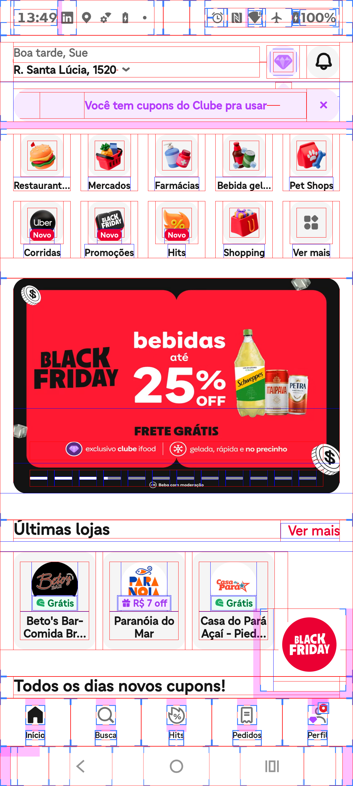
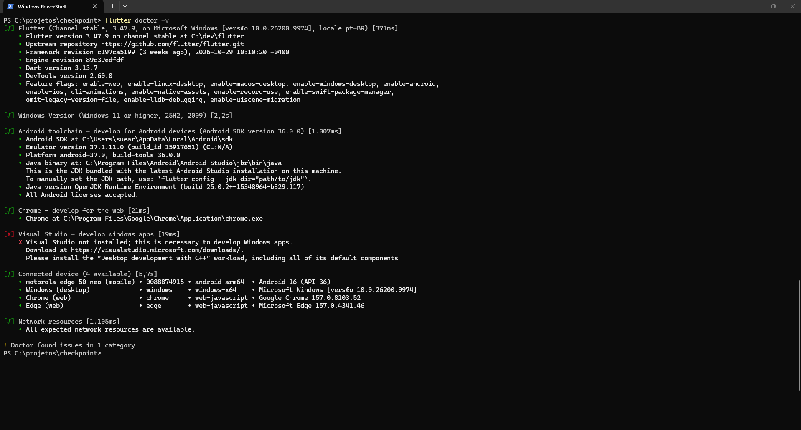
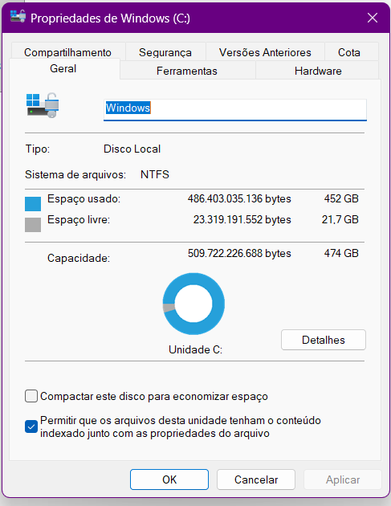
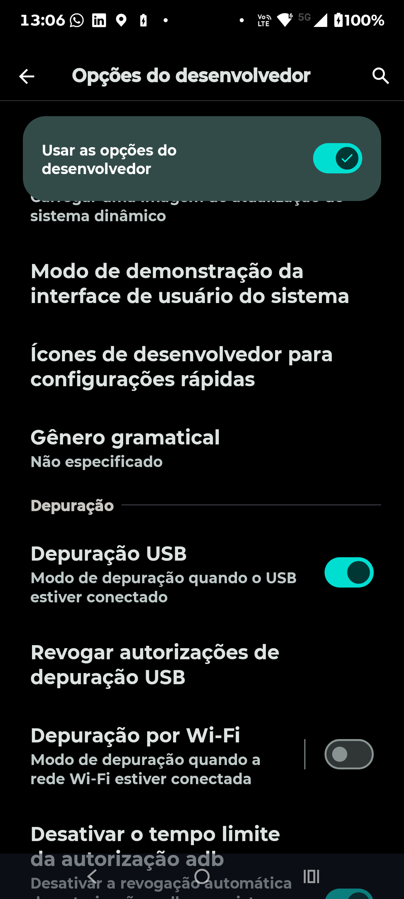
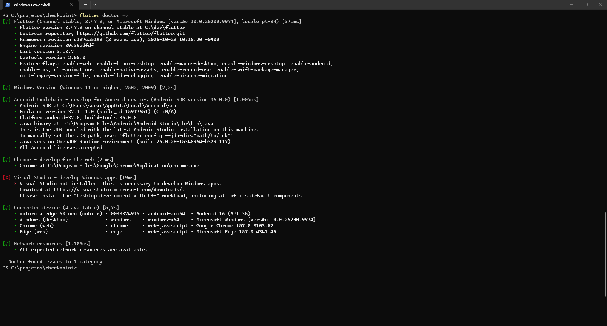

# Aula 01 — Respostas

**Aluno(a):** Sue Hellen Arruda da Silva

**Repositório do Checkpoint (Lab 01):** https://github.com/suehellenarruda/checkpoint

---

## Parte A

Apps testados no meu celular (motorola edge 50 neo, Android 16): **Spotify** (internacional — Suécia), **iFood** (brasileiro) e **Mercado Livre** (latino-americano).

### A1

#### App: Spotify

| Item | Resposta |
|---|---|
| Categoria | streaming de música e podcasts |
| A rolagem é fluida ou engasga? | Fluida, sem travadas perceptíveis. |
| A aparência é igual à de outros apps do Android? | Não. Tem identidade visual própria (fundo escuro, verde da marca, tipografia própria) e não segue o padrão Material do Android; a barra inferior e os cartões são do design system do próprio Spotify. |
| Funciona em modo avião? O que ainda dá para fazer? | Sim, parcialmente. Detecta o modo offline e mostra a faixa "Você está offline"; a tela inicial continua exibindo as playlists salvas, e a música baixada (marcada com ✓ verde) segue disponível no player. Avisa que os downloads aparecem nessa área enquanto estiver offline. |
| Abordagem que eu **chuto** | nativo |
| Evidência do meu chute | print com "Mostrar limites de layout" (A2) |

#### App: iFood

| Item | Resposta |
|---|---|
| Categoria | delivery (restaurantes, mercados, farmácias) |
| A rolagem é fluida ou engasga? | Fluida, sem travadas perceptíveis. |
| A aparência é igual à de outros apps do Android? | Em parte. Tem identidade própria (vermelho e roxo do Clube, ilustrações 3D nos atalhos), mas a barra de navegação inferior com 5 ícones segue o padrão comum dos apps Android. |
| Funciona em modo avião? O que ainda dá para fazer? | Quase nada. Abre o app e mostra o endereço e a barra inferior, mas a tela inicial vira um erro genérico ("Algo deu errado por aqui… tente outra vez") — nem avisa que o problema é falta de internet. Não dá para ver lojas nem pedidos. |
| Abordagem que eu **chuto** | nativo |
| Evidência do meu chute | print com "Mostrar limites de layout" (A2) |

#### App: Mercado Livre

| Item | Resposta |
|---|---|
| Categoria | e-commerce / marketplace |
| A rolagem é fluida ou engasga? | Fluida, sem travadas perceptíveis. |
| A aparência é igual à de outros apps do Android? | Em parte. Usa a identidade da marca (amarelo, componentes próprios), mas a barra de navegação inferior e os ícones lembram o padrão Material de outros apps Android. |
| Funciona em modo avião? O que ainda dá para fazer? | Pouco. Mantém o cabeçalho (busca, endereço) e a barra inferior, mas o conteúdo é substituído por uma tela clara: "Não há conexão com a internet — verifique sua conexão" com botão "Tentar novamente". Não mostra produtos salvos. |
| Abordagem que eu **chuto** | nativo |
| Evidência do meu chute | print com "Mostrar limites de layout" (A2) |

### A2

Usei a opção **Opções do desenvolvedor → Mostrar limites de layout** e capturei a tela de cada app. O raciocínio: em um app **nativo** (e também em React Native, que usa componentes nativos), cada elemento da tela — texto, imagem, botão — é uma *View* separada do Android, então aparece um retângulo em volta de cada um. Em um app **Flutter**, o Android enxerga só uma "tela de pintura" grande (o Flutter desenha tudo por conta própria), então aparecem pouquíssimos retângulos. Em uma **WebView**, aparece um retângulo grande na área da página.

- **Spotify:** cada capa de playlist, cada título, o mini player e cada botão da barra inferior têm o seu próprio retângulo → hierarquia de Views nativas. Indica **nativo** (a técnica não separa nativo de React Native, mas descarta Flutter e WebView).
  
- **iFood:** cada atalho de categoria (ícone e texto separados), cada card de "Últimas lojas", o banner e cada item da barra inferior têm seu próprio retângulo → Views nativas. Indica **nativo**, descartando Flutter e WebView nesta tela.
  
- **Mercado Livre:** cada preço, etiqueta ("MAIS VENDIDO", "% OFF"), ícone de atalho e item da barra inferior aparece contornado individualmente → Views nativas. Indica **nativo**, descartando Flutter.
  

### A3

Fiz o teste com **modo avião ligado e Wi-Fi desligado** (só o ícone ✈ na barra de status).

O **Spotify** se comportou muito melhor que os outros dois. Ele **percebe** que está offline e muda de comportamento: mostra a faixa azul "Você está offline", continua exibindo as playlists já carregadas e reorganiza a tela inicial para destacar os **downloads** (músicas e episódios baixados), que seguem disponíveis — a música com ✓ verde continua no player. Ou seja, ele guarda dados no próprio aparelho e foi projetado para funcionar sem rede.

O **Mercado Livre** ao menos é honesto: mantém cabeçalho e navegação e explica "Não há conexão com a internet", com botão para tentar de novo — mas não oferece nada para fazer offline. O **iFood** foi o pior: mostra um erro genérico ("Algo deu errado por aqui"), sem dizer que a causa é a falta de rede.

A diferença é que o Spotify é **offline-first**: trata a falta de internet como um estado normal e usa dados locais; os outros dois dependem do servidor para montar cada tela. É o mesmo comportamento que o Checkpoint precisa ter para técnicos em campo sem sinal.

---

## Parte B

### B1 — Startup com 2 devs, 3 meses, Android e iOS

**Abordagem: Flutter.**
Com só duas pessoas e três meses, manter duas bases nativas (Kotlin e Swift) dividiria a equipe pela metade e dobraria o trabalho de cada tela. Uma base única em Flutter deixa os dois devs entregando para as duas lojas ao mesmo tempo, e o hot reload acelera o ciclo de ajuste de interface. O custo de manutenção a longo prazo também fica menor, porque cada correção é feita uma vez só. Fatores considerados: **prazo**, **tamanho da equipe**, **custo de manutenção**.

### B2 — Edição de vídeo com filtros em tempo real

**Abordagem: nativo (Kotlin + Swift).**
Filtros em tempo real exigem acesso direto à câmera, à GPU e aos codecs de hardware (Metal no iOS, Vulkan/OpenGL e MediaCodec no Android), e qualquer quadro perdido é visível para o usuário. Em Flutter, esse processamento teria de ser feito em código nativo de qualquer jeito, via platform channels, e a camada Flutter ficaria só com os botões — pagando o custo de duas tecnologias sem ganhar a base única onde mais importa. Nativo dá o máximo de **desempenho** e **acesso a hardware**, e as bibliotecas de vídeo maduras de cada plataforma já estão prontas. Fatores: **exigência de desempenho**, **acesso a hardware**, **custo de manutenção**.

### B3 — Portal de notícias de um jornal que já tem site responsivo

**Abordagem: web (PWA) ou um app leve com WebView.**
O conteúdo já existe e é publicado no site; um app de notícias é basicamente leitura de texto e imagem, sem exigência alta de desempenho nem de hardware. Transformar o site em PWA (ou embrulhá-lo em WebView, somando notificações push) reaproveita a equipe web que o jornal já tem e evita manter uma terceira base de código. O visual não precisa parecer "da plataforma" — precisa parecer do jornal. Fatores: **custo de manutenção**, **equipe existente**, **exigência de desempenho** baixa, **prazo**.

### B4 — App bancário com biometria e certificado no aparelho

**Abordagem: nativo.**
Biometria e certificado armazenado exigem integração profunda com o Keychain/Secure Enclave no iOS e o Android Keystore/StrongBox, além de proteções contra root/jailbreak e auditorias de segurança. Com nativo, a equipe usa diretamente as APIs de segurança de cada sistema, assim que são lançadas, sem depender de plugins de terceiros que viram superfície de ataque. Bancos grandes também têm orçamento e equipes para manter duas bases. (Contraponto honesto: o Nubank usa Flutter — mas mantém código nativo para as partes sensíveis, o que confirma que a segurança fica no nativo.) Fatores: **acesso a hardware**, **custo de manutenção** (segurança auditável), **tamanho da equipe**.

### B5 — App interno, só Android, 200 funcionários em campo sem internet

**Abordagem: Flutter.**
O ponto central é funcionar offline e sincronizar depois (offline-first), e o Flutter tem pacotes maduros para isso (SQLite, armazenamento local, fila de sincronização). Mesmo sendo só Android hoje, uma base Flutter deixa a porta aberta para iOS ou web sem reescrever, e é mais fácil de contratar e treinar do que equipes nativas separadas. O visual não precisa ser "da plataforma", pois é um app de uso interno, e o desempenho exigido é o de formulários e listas, que o Flutter atende bem. Fatores: **custo de manutenção**, **quanto o visual precisa ser da plataforma**, **disponibilidade de contratação**, **prazo**.

### B6 — Jogo 2D casual com física e placar online

**Abordagem: engine de jogos (Godot ou Unity).**
Jogos precisam de loop de renderização, física, colisão, áudio e editor de cenas — tudo isso já vem pronto em uma engine e é o que a equipe de jogos do mercado sabe usar. Unity e Godot exportam para Android e iOS a partir da mesma base, e o placar online é um serviço simples de backend. Flutter com o pacote Flame é viável para jogos muito simples, mas o ecossistema de ferramentas e de profissionais é muito menor. Fatores: **exigência de desempenho**, **disponibilidade de contratação**, **prazo**.

---

## Parte C

### C1

#### Caso 1 — Nubank

- **Antes:** apps nativos separados para iOS e Android, com equipes especializadas. Faltavam especialistas nativos no mercado, e as funcionalidades saíam em datas diferentes em cada plataforma.
- **Por que migrou:** escrever cada funcionalidade duas vezes era desperdício, e equipes separadas por plataforma não escalavam. Uma força-tarefa comparou Kotlin Native, React Native e Flutter em 11 critérios e escolheu Flutter pela experiência do desenvolvedor, documentação, API estável e ferramentas de teste.
- **Ganhos mensuráveis:** taxa de sucesso de merge cerca de 30% maior que no nativo; PRs integrados em média em 9,9 min contra 70,45 min; um produto de seguro de vida lançado em 3 meses (antes, lançamentos levavam de meses a um ano); engenheiros novos contribuindo em dias.
- **Dificuldades:** a migração foi gradual e longa — o app ainda convivia com partes nativas — e exigiu criar ferramentas próprias de tradução, adaptar pipelines de build/teste/deploy e treinar as equipes.
- **Fontes:**
  - https://flutter.dev/showcase/nubank
  - https://building.nubank.com/why-we-think-flutter-will-help-us-scale-mobile-development-at-nubank/
  - https://building.nubank.com/scaling-with-flutter/

#### Caso 2 — BMW (My BMW App)

- **Antes:** apps nativos separados para iOS e Android; o iOS recebia mais atenção e o Android ficava para trás em funcionalidades e design.
- **Por que migrou:** dobrar as equipes de iOS para cuidar do Android dobraria custo e esforço, e o app precisava ter as mesmas funções em vários sistemas, marcas (BMW e MINI) e mais de 45 países.
- **Ganhos mensuráveis:** o My BMW App foi lançado em julho de 2020, menos de um ano após o início; roda em 47 países; cada build gera 96 variantes construídas, testadas e publicadas automaticamente; a diferença de funcionalidades entre plataformas acabou.
- **Dificuldades:** desconfiança inicial dos engenheiros sobre a maturidade do Flutter; reescrever todas as variantes em uma base única; gerenciar regras locais de cada país; reorganizar as equipes por domínio.
- **Fontes:**
  - https://flutter.dev/showcase/bmw
  - https://www.press.bmwgroup.com/global/article/detail/T0328610EN/the-my-bmw-app:-new-features-and-tech-insights-for-march-2021

### C2 — Airbnb abandonou React Native

- **Razões alegadas:**
  - *Técnicas:* a inicialização e a primeira renderização assíncrona dificultavam metas de qualidade; era preciso manter código de "ponte" (bridge), ou seja, três plataformas em vez de duas; o compartilhamento de código com a web ficou muito abaixo do esperado; a depuração piorou; integrar o modelo híbrido a apps nativos grandes gerou atrito.
  - *Organizacionais:* só uma pequena parte do app era React Native, então o investimento não se pagava; faltavam recursos internos e externos para resolver os problemas técnicos.
- **Se aplicariam ao Flutter?** Em parte. A ponte JavaScript↔nativo e a primeira renderização lenta são problemas da arquitetura do React Native da época; o Flutter compila para código nativo (AOT) e desenha a própria interface, então não tem essa ponte. Já os problemas organizacionais valem para qualquer tecnologia cross-platform: integrar Flutter em um app nativo grande já existente (add-to-app) também gera atrito, e se só uma fatia pequena do app usar Flutter, a empresa continua pagando o custo de três stacks.
- **O que ensina sobre quando NÃO usar cross-platform:** quando a empresa já tem equipes nativas fortes e um app grande e maduro, adotar cross-platform só em partes soma custos em vez de reduzir. Cross-platform compensa quando é a tecnologia principal do app, não um enxerto.
- **Fonte:** https://medium.com/airbnb-engineering/sunsetting-react-native-1868ba28e30a

---

## Parte D

### D1



- [x] Flutter SDK (instalado: 3.47.9 stable, mais nova que a 3.35 indicada)
- [x] Android Studio (já instalado — confirmado no `flutter doctor`)
- [x] VS Code + extensão Flutter (VS Code 1.138)

### D2



Espaço livre: 21,7 GB (acima dos 20 GB exigidos).

### D3



Celular: motorola edge 50 neo (Android 16), com Depuração USB ativa — ele aparece em `flutter devices` / `flutter doctor` como dispositivo conectado.

---

## Bônus — flutter doctor



```
[√] Flutter (Channel stable, 3.47.9, on Microsoft Windows [versão 10.0.26200.9974], locale pt-BR) [371ms]
    • Flutter version 3.47.9 on channel stable at C:\dev\flutter
    • Upstream repository https://github.com/flutter/flutter.git
    • Framework revision c197ca5199 (3 weeks ago), 2026-10-29 10:10:20 -0400
    • Engine revision 89c39edfdf
    • Dart version 3.13.7
    • DevTools version 2.60.0
    • Feature flags: enable-web, enable-linux-desktop, enable-macos-desktop, enable-windows-desktop, enable-android,
      enable-ios, cli-animations, enable-native-assets, enable-record-use, enable-swift-package-manager,
      omit-legacy-version-file, enable-lldb-debugging, enable-uiscene-migration

[√] Windows Version (Windows 11 or higher, 25H2, 2009) [2,2s]

[√] Android toolchain - develop for Android devices (Android SDK version 36.0.0) [1.007ms]
    • Android SDK at C:\Users\suear\AppData\Local\Android\sdk
    • Emulator version 37.1.11.0 (build_id 15917651) (CL:N/A)
    • Platform android-37.0, build-tools 36.0.0
    • Java binary at: C:\Program Files\Android\Android Studio\jbr\bin\java
      This is the JDK bundled with the latest Android Studio installation on this machine.
      To manually set the JDK path, use: `flutter config --jdk-dir="path/to/jdk"`.
    • Java version OpenJDK Runtime Environment (build 25.0.2+-15348964-b329.117)
    • All Android licenses accepted.

[√] Chrome - develop for the web [21ms]
    • Chrome at C:\Program Files\Google\Chrome\Application\chrome.exe

[X] Visual Studio - develop Windows apps [19ms]
    X Visual Studio not installed; this is necessary to develop Windows apps.
      Download at https://visualstudio.microsoft.com/downloads/.
      Please install the "Desktop development with C++" workload, including all of its default components

[√] Connected device (4 available) [5,7s]
    • motorola edge 50 neo (mobile) • 0088874915 • android-arm64  • Android 16 (API 36)
    • Windows (desktop)             • windows    • windows-x64    • Microsoft Windows [versão 10.0.26200.9974]
    • Chrome (web)                  • chrome     • web-javascript • Google Chrome 157.0.8103.52
    • Edge (web)                    • edge       • web-javascript • Microsoft Edge 157.0.4341.46

[√] Network resources [1.105ms]
    • All expected network resources are available.

! Doctor found issues in 1 category.
```

**O que cada item significa:**

- **[X] Visual Studio — develop Windows apps:** é o único problema encontrado. O Visual Studio (com o pacote "Desktop development with C++") só é necessário para gerar apps **de desktop para Windows**. A disciplina mira Android (e web como plano B), então esse ✗ **não impede nada** do que vamos fazer — por isso não vou instalá-lo.
- **[√] Flutter:** SDK 3.47.9 no canal stable, instalado em `C:\dev\flutter` e já no `PATH`. É uma versão mais nova que a 3.35 indicada no lab; os comandos usados funcionam igual.
- **[√] Android toolchain:** o Android Studio já está instalado, com o Android SDK 36, o emulador, o Java (JDK que vem com o Android Studio) e **todas as licenças aceitas**. É o que permite compilar para Android.
- **[√] Chrome:** permite rodar o app na web, que foi o plano B do Lab 01.
- **[√] Connected device (4):** o Flutter enxerga meu celular **motorola edge 50 neo (Android 16)** via cabo USB — sinal de que a Depuração USB está ativa e autorizada —, além do próprio Windows, do Chrome e do Edge.
- **[√] Network resources:** o Flutter consegue acessar os servidores de pacotes e atualizações.
