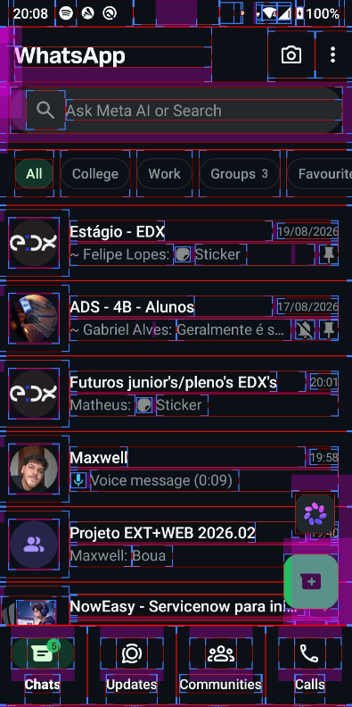
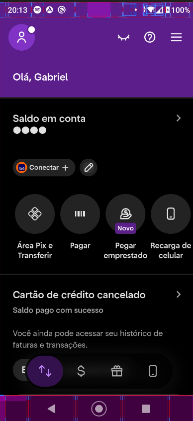
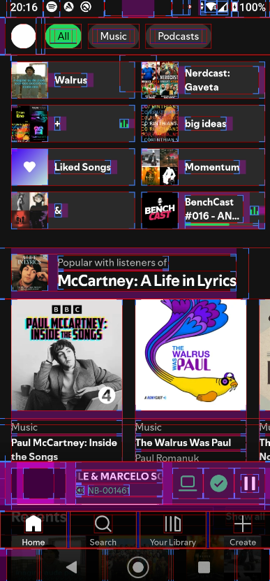
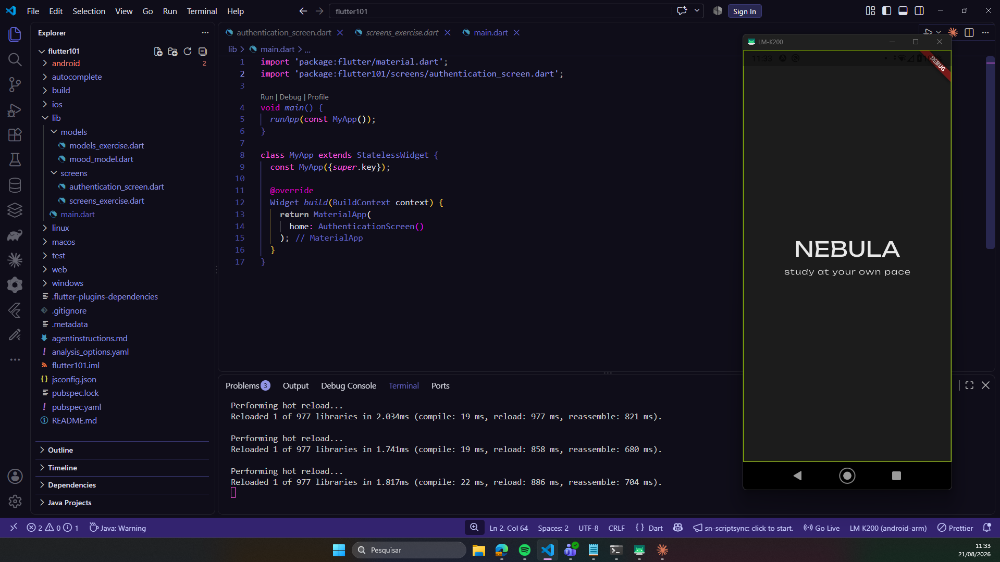
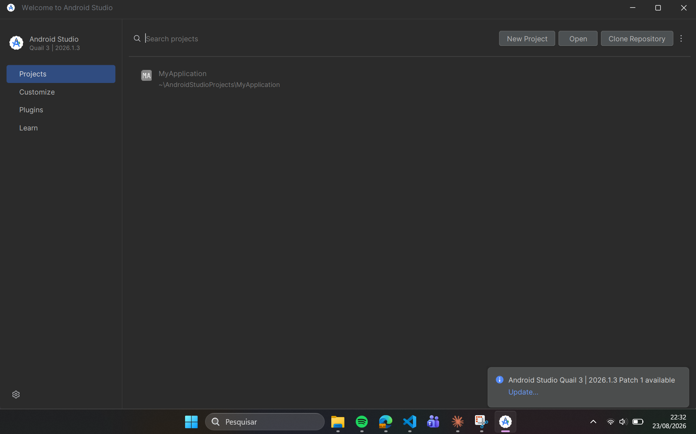
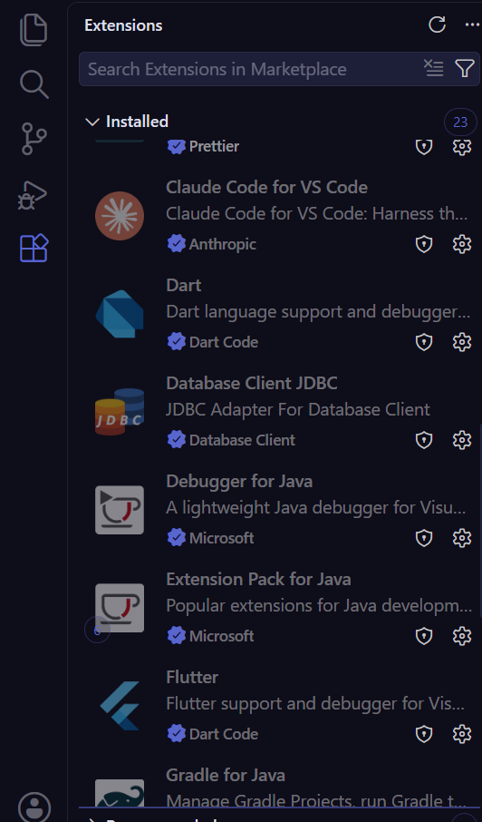
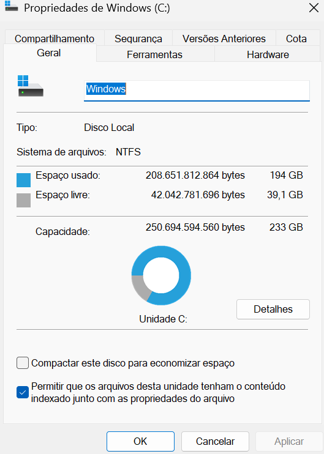
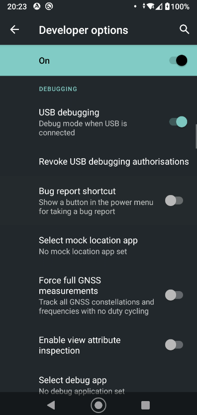

# Respostas — Aula 01: O Ecossistema Mobile e o Lugar do Flutter

**Nome:** Gabriel Vasconcelos Martins Paz

---

## Parte A — Análise de apps reais

### App: WhatsApp

| Item | Resposta |
|---|---|
| Categoria | mensagens / rede social |
| A rolagem é fluida ou engasga? | fluida |
| A aparência é igual à de outros apps do Android? | similar ao duolingo em questão paleta de cores e etc. mas nada exatamente igual |
| Funciona em modo avião? O que ainda dá para fazer? | funciona, mas a mensagens obviamente não são enviadas, os status não carregam, não dá para mudar foto de perfil e etc |
| Abordagem que eu **chuto** | react native |
| Evidência do meu chute |  |

### App: Nubank

| Item | Resposta |
|---|---|
| Categoria | banco |
| A rolagem é fluida ou engasga? | fluida |
| A aparência é igual à de outros apps do Android? | não consigo pensar em algum similar |
| Funciona em modo avião? O que ainda dá para fazer? | não dá pra fazer nada |
| Abordagem que eu **chuto** | nativo |
| Evidência do meu chute |  |

### App: Spotify

| Item | Resposta |
|---|---|
| Categoria | streaming de música |
| A rolagem é fluida ou engasga? | fluida |
| A aparência é igual à de outros apps do Android? | não |
| Funciona em modo avião? O que ainda dá para fazer? | acesso as músicas baixadas (feature acessivel atraves do plano premium) |
| Abordagem que eu **chuto** | flutter |
| Evidência do meu chute |  |

### A3 — Teste do modo avião

spotify foi o que se comportou melhor porque foi o que manteve sua funcionalidade principal mesmo offline.

---

## Parte B — Escolhendo a abordagem

### B1 — Startup, 2 devs, 3 meses, Android e iOS
Flutter. Um código só reduz o esforço e manutenção depois, e tem bastante desenvolvedor disponível no mercado pra contratar.

### B2 — App de edição de vídeo com filtros em tempo real
Nativo. Processamento de imagem quadro a quadro exige acesso direto à GPU e à câmera. Mesmo pacotes Flutter que fazem isso chamam código nativo por baixo, então o trabalho pesado seria nativo de qualquer jeito.

### B3 — Portal de notícias com site responsivo
WebView. O site já existe e funciona; reescrever em Flutter ou nativo seria retrabalho sem ganho, já que o conteúdo é majoritariamente texto/imagem e não exige nada de hardware.

### B4 — App bancário com biometria e certificado no aparelho
Nativo. Pelo que eu entendi é melhor na questão de segurança. fica mais confiável com acesso direto às APIs do sistema, sem depender de plugin pra dados sensíveis.

### B5 — App interno, só Android, 200 funcionários em campo sem internet
Nativo. Sendo só Android, é kotlin.

### B6 — Jogo 2D casual com física e placar online
Flutter. O pacote Flame adiciona ao Flutter o que falta pra
jogos (game loop, colisão, sprites e etc) Pra um jogo casual 2D isso dá conta bem, mantendo um código só pra Android e iOS. O placar online é só uma chamada HTTP normal.

---

## Parte C — Pesquisa: migrações reais

### C1 — Dois casos de migração para Flutter

BMW Group: consolidou mais de 20 apps em Flutter, saindo
de desenvolvimento nativo. Ganho relatado: entregar uma feature nova pra todos os apps de uma vez, sem duplicar trabalho em Kotlin e Swift. Dificuldade: curva de aprendizado das equipes nativas e recriar componentes visuais da marca no Flutter. Anteriormente, a marca focava muito mais em iOS.

fonte: https://flutter.dev/showcase/bmw

eBay Motors: reescreveu esse app variado do app do eBay principal em Flutter. Ganho: menos gente necessária pra manter padrão entre plataformas. Dificuldade: portar integrações específicas (pagamento, notificações e etc) pros plugins do Flutter e a equipe tendo que aprender dart muito rápido.

fonte: https://flutter.dev/showcase/ebay

### C2 — Um caso de abandono de cross-platform
Depois de mais ou menos dois anos, a empresa anunciou em 2018 que iria voltar com o desenvolvimento nativo. o react native ainda era bem embrião, o principal pelo que eu entendi, foi que pra fazer o react native funcionar dentro da infraestrutura existente, a empresa precisou criar uma quantidade absurda de gambiarras nos códigos e isso reduziu parte do benefício da facilidade que esperavam obter com o multiplataforma.

fonte: https://medium.com/airbnb-engineering/sunsetting-react-native-1868ba28e30a

---

## Parte D — Preparação do ambiente

### D1 — Downloads

### D2 — Espaço em disco

### D3 — Depuração USB / celular Android

### Bônus — flutter doctor -v

(consta erro em relação ao vscode, mas está instalado obviamente)

[√] Flutter (Channel stable, 3.44.9, on Microsoft Windows [versÆo 10.0.26200.9168], locale pt-BR) [245ms]
    • Flutter version 3.44.9 on channel stable at C:\flutter\src
    • Upstream repository https://github.com/flutter/flutter.git
    • Framework revision 6b182d2c75 (3 weeks ago), 2026-08-05 10:04:07 -0700
    • Engine revision 5a2a6a42cc
    • Dart version 3.12.2
    • DevTools version 2.57.0
    • Feature flags: enable-web, enable-linux-desktop, enable-macos-desktop, enable-windows-desktop, enable-android, enable-ios, cli-animations,
      enable-native-assets, enable-swift-package-manager, omit-legacy-version-file, enable-lldb-debugging, enable-uiscene-migration

[√] Windows Version (Windows 11 or higher, 25H2, 2009) [877ms]

[√] Android toolchain - develop for Android devices (Android SDK version 37.0.0) [2,8s]
    • Android SDK at C:\Users\Colaborador\AppData\Local\Android\sdk
    • Emulator version 37.1.11.0 (build_id 15917651) (CL:N/A)
    • Platform android-37.0, build-tools 37.0.0
    • Java binary at: C:\Program Files\Android\Android Studio\jbr\bin\java
      This is the JDK bundled with the latest Android Studio installation on this machine.
      To manually set the JDK path, use: `flutter config --jdk-dir="path/to/jdk"`.
    • Java version OpenJDK Runtime Environment (build 25.0.2+-15348964-b329.117)
    • All Android licenses accepted.

[√] Chrome - develop for the web [16ms]
    • Chrome at C:\Program Files\Google\Chrome\Application\chrome.exe

[X] Visual Studio - develop Windows apps [15ms]
    X Visual Studio not installed; this is necessary to develop Windows apps.
      Download at https://visualstudio.microsoft.com/downloads/.
      Please install the "Desktop development with C++" workload, including all of its default components

[√] Connected device (4 available) [384ms]
    • LM K200 (mobile)  • d2a6da3c • android-arm    • Android 10 (API 29)
    • Windows (desktop) • windows  • windows-x64    • Microsoft Windows [versÆo 10.0.26200.9168]
    • Chrome (web)      • chrome   • web-javascript • Google Chrome 151.0.7922.170
    • Edge (web)        • edge     • web-javascript • Microsoft Edge 151.0.4129.101

[√] Network resources [661ms]
    • All expected network resources are available.

! Doctor found issues in 1 category.