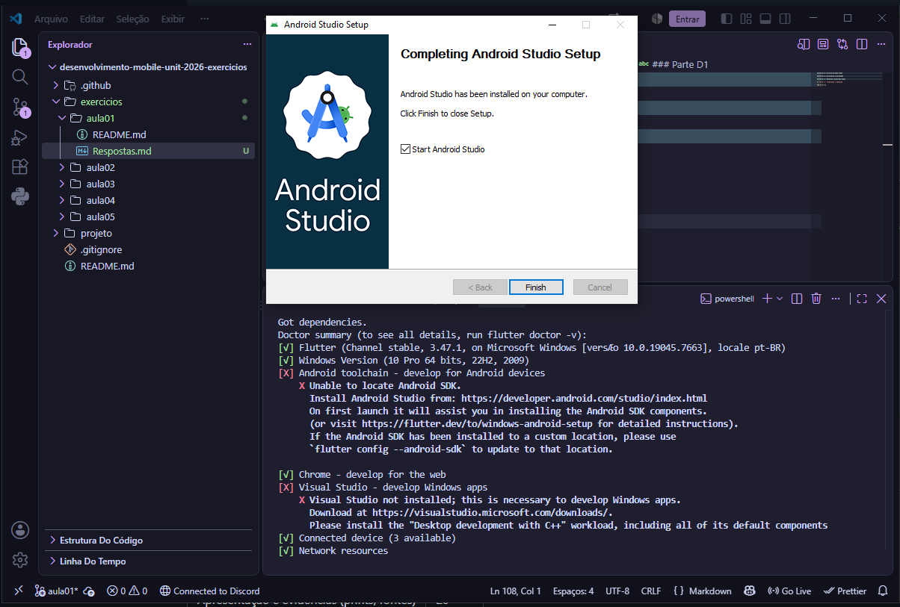

## Parte A - Análise de apps reais

### A1 e A2

### App: <Instagram>

| Item | Resposta |
|---|---|
| Categoria | Rede Social |
| A rolagem é fluida ou engasga? | É bem fluida na maior parte do tempo, mesmo com bastante vídeo e imagem no feed. |
| A aparência é igual à de outros apps do Android? | Não muito. Ele tem um visual próprio, principalmente nos ícones, menus e na organização das telas. |
| Funciona em modo avião? O que ainda dá para fazer? | Fica bem limitado. Algumas coisas que já estavam carregadas continuam aparecendo, mas não consigo atualizar o feed nem carregar conteúdos novos. |
| Abordagem que eu **chuto** | React Native |
| Evidência do meu chute | O AppBrain mostra React Native entre as bibliotecas usadas pelo Instagram no Android. Também aparecem bibliotecas como React Native SVG, o que reforça esse palpite. (https://www.appbrain.com/app/instagram/com.instagram.airwave)|

### App: <Spotify>

| Item | Resposta |
|---|---|
| Categoria | Música / streaming |
| A rolagem é fluida ou engasga? | É bem tranquila, principalmente passando pelas playlists e pela tela inicial. |
| A aparência é igual à de outros apps do Android? | Não. O Spotify tem um visual bem próprio e é fácil reconhecer o aplicativo. |
| Funciona em modo avião? O que ainda dá para fazer? | Sim, mas só com o que já foi baixado. Dá para ouvir músicas disponíveis offline, mas não dá para pesquisar ou carregar músicas novas. |
| Abordagem que eu **chuto** | Nativo |
| Evidência do meu chute | Uma evidência é o uso do Spotify App Remote SDK, que possui SDKs próprios para Android e iOS. Isso combina com a necessidade do aplicativo de trabalhar diretamente com reprodução de áudio e recursos específicos de cada plataforma. (https://pub.dev/documentation/spotify_sdk/latest/)|

### App: <Nubank>

| Item | Resposta |
|---|---|
| Categoria | Banco |
| A rolagem é fluida ou engasga? | É bem fluida e não costuma travar enquanto estou passando pelas opções do aplicativo. |
| A aparência é igual à de outros apps do Android? | Não. O Nubank tem um visual próprio, principalmente pelas cores e pela forma como apresenta as informações. |
| Funciona em modo avião? O que ainda dá para fazer? | Fica praticamente inutilizável. Algumas telas podem abrir, mas não consigo consultar a conta ou fazer operações normalmente. |
| Abordagem que eu **chuto** | Flutter |
| Evidência do meu chute | Essa é a mais fácil de comprovar: o próprio Nubank publicou que escolheu o Flutter como tecnologia principal para o desenvolvimento mobile. A empresa também explica que o aplicativo ainda possui partes antigas em tecnologias nativas e React Native, enquanto as novas funcionalidades passaram a ser feitas em Flutter. (https://building.nubank.com/pt-br/por-que-achamos-que-o-flutter-vai-nos-ajudar-a-escalar-o-desenvolvimento-movel-no-nubank/)|

### A3

Depois de testar os três, o Spotify foi o que se comportou melhor sem internet. A diferença é que ele consegue deixar músicas salvas no aparelho para serem reproduzidas depois, então mesmo sem conexão ainda consigo ouvir o conteúdo que já baixei. Já Instagram e Nubank dependem muito mais da internet para carregar as informações principais do aplicativo.

## Parte B - Escolhendo a abordagem

### B1 — Startup com 2 devs, 3 meses de prazo, Android e iOS
#### Abordagem: React Native
Aqui eu escolheria nativo porque filtros em tempo real podem exigir bastante do aparelho e qualquer atraso acaba sendo perceptível para o usuário. O acesso mais direto aos recursos do celular ajuda no desempenho, que nesse caso é mais importante do que a facilidade de reaproveitar código. Além disso, edição de vídeo é um tipo de aplicação em que eu não arriscaria perder desempenho por causa da tecnologia escolhida.

### B2 — App de edição de vídeo com filtros aplicados em tempo real
#### Abordagem: Nativo
Aqui eu escolheria nativo porque filtros em tempo real podem exigir bastante do aparelho e qualquer atraso acaba sendo perceptível para o usuário. O acesso mais direto aos recursos do celular ajuda no desempenho, que nesse caso é mais importante do que a facilidade de reaproveitar código. Além disso, edição de vídeo é um tipo de aplicação em que eu não arriscaria perder desempenho por causa da tecnologia escolhida.

### B3 — Portal de notícias de um jornal que já tem site responsivo
#### Abordagem: WebView
Eu escolheria WebView porque o jornal já tem um site responsivo funcionando, então boa parte do trabalho já está pronta. Não faria muito sentido criar todo o portal novamente só para ter uma versão em aplicativo. Também seria uma opção mais rápida e barata de manter.

### B4 — App bancário com biometria e certificado armazenado no aparelho
#### Abordagem: Nativo
Eu escolheria nativo porque esse aplicativo precisa acessar recursos de segurança do próprio aparelho, como a biometria e o certificado. Em um aplicativo bancário, eu colocaria segurança e estabilidade acima da facilidade de desenvolvimento. O nativo também permite trabalhar melhor com as funções específicas de Android e iOS.

### B5 — App interno de uma empresa, só Android, 200 funcionários em campo sem internet
#### Abordagem: Nativo
Eu escolheria nativo porque o aplicativo vai ser usado somente no Android, então não existe a necessidade de manter duas plataformas. Como os funcionários vão usar em locais sem internet, também é importante ter um bom controle do armazenamento e dos recursos do aparelho. Nesse caso, eu acho que o ganho de ter uma tecnologia específica para Android compensa.

### B6 — Jogo 2D casual com física e placar online
#### Abordagem: Flutter
Eu escolheria Flutter porque é um jogo 2D casual e não parece exigir um nível muito alto de processamento gráfico. Também dá para aproveitar boa parte do código caso o jogo seja lançado para Android e iOS. Para esse tamanho de projeto, acho mais interessante ganhar tempo no desenvolvimento do que fazer duas versões separadas.

## Parte C - Pesquisa: migrações reais

### C1: Caso 1 - Nubank
O Nubank tinha um aplicativo grande que usava uma mistura de Objective-C, Swift, Java, Kotlin e React Native, e decidiu adotar o Flutter como principal tecnologia para desenvolvimento multiplataforma. A ideia era facilitar o trabalho entre as equipes e conseguir desenvolver novos produtos mais rapidamente, usando uma base mais padronizada.

Um resultado que achei interessante foi o tempo de integração dos novos desenvolvedores: segundo o próprio Nubank, eles conseguiam começar a contribuir no aplicativo em questão de dias. Também houve uma melhora grande no tempo de compilação: PRs em Flutter levavam em média 9,9 minutos, enquanto a média geral das outras plataformas era de 70,45 minutos.

A migração não foi simples porque o aplicativo era muito grande e ainda tinha várias partes antigas em tecnologias diferentes. Eles também encontraram problemas ao integrar o Flutter com partes nativas que já existiam, além de problemas de desempenho que precisaram de uma equipe de plataforma para resolver.

Fonte: https://building.nubank.com/pt-br/expandindo-o-desenvolvimento-movel-do-nubank-com-o-flutter/

### C1: Caso 2 - Google Pay
O Google Pay tinha cerca de 1,7 milhão de linhas de código somando as versões Android e iOS. Como cada plataforma precisava de um desenvolvimento separado, a equipe decidiu migrar para Flutter para conseguir trabalhar com uma base de código compartilhada e facilitar a expansão do aplicativo para outros países.

A mudança trouxe resultados bem grandes: o novo código ficou 35% menor, passando de 1,7 milhão para cerca de 1,1 milhão de linhas. A equipe também estimou uma economia de aproximadamente 60% a 70% do tempo dos engenheiros.

O problema é que a migração exigiu bastante trabalho antes de trazer esses ganhos. A equipe precisou aprender Dart e Flutter, reescrever o aplicativo enquanto ele continuava recebendo atualizações e passar novamente por revisões e auditorias de segurança. Para começar, três engenheiros fizeram uma versão inicial e depois a equipe chegou a 50 engenheiros durante seis meses para preparar o primeiro lançamento.

Fonte: https://flutter.dev/showcase/google-pay

### C2: Caso 3 - Airbnb: abandonando React Native
A Airbnb começou a usar React Native em 2016 porque não tinha desenvolvedores mobile suficientes e queria conseguir desenvolver para Android e iOS com mais velocidade. Porém, depois de alguns anos, a empresa decidiu parar de investir no React Native e voltar para o desenvolvimento nativo.

Um dos problemas foi a dificuldade de lidar com situações que precisavam de código específico de Android ou iOS. A empresa também teve problemas com acessibilidade, atualizações do React Native, crashes difíceis de reproduzir e a necessidade de manter uma mistura de código nativo e React Native.

Além disso, a Airbnb percebeu que manter uma equipe que precisava entender React, Android e iOS ao mesmo tempo aumentava a complexidade. Por isso, decidiu voltar para o nativo e migrar as telas mais importantes para essa abordagem.

Esses problemas também poderiam acontecer com Flutter?
Alguns sim, principalmente quando o aplicativo depende muito de recursos específicos de cada sistema ou precisa misturar bastante código nativo com o Flutter. Mas não significa que o Flutter teria exatamente os mesmos problemas, já que React Native e Flutter funcionam de maneiras diferentes.

O que esse caso ensina?
Para mim, o principal é que cross-platform não é automaticamente a melhor escolha só porque permite reaproveitar código. Se o aplicativo depende muito de recursos específicos do Android e iOS, ou se a equipe já é muito especializada em desenvolvimento nativo, pode fazer mais sentido continuar no nativo.

Fonte: https://medium.com/airbnb-engineering/sunsetting-react-native-1868ba28e30a

## Parte D - Preparando o ambiente

### D1

### D2

### D3

Não possuo Android.

