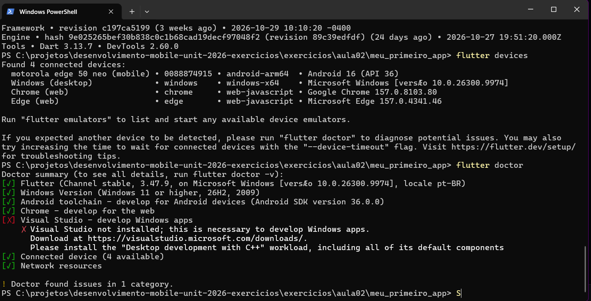
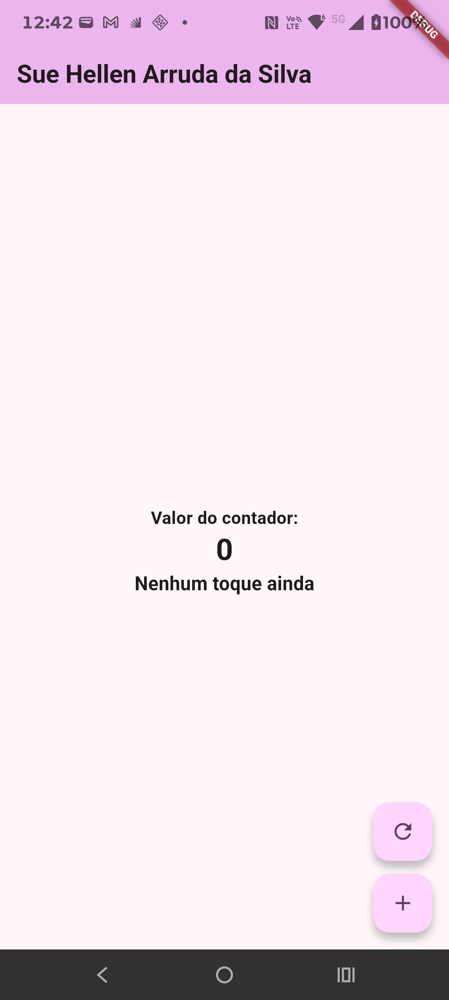
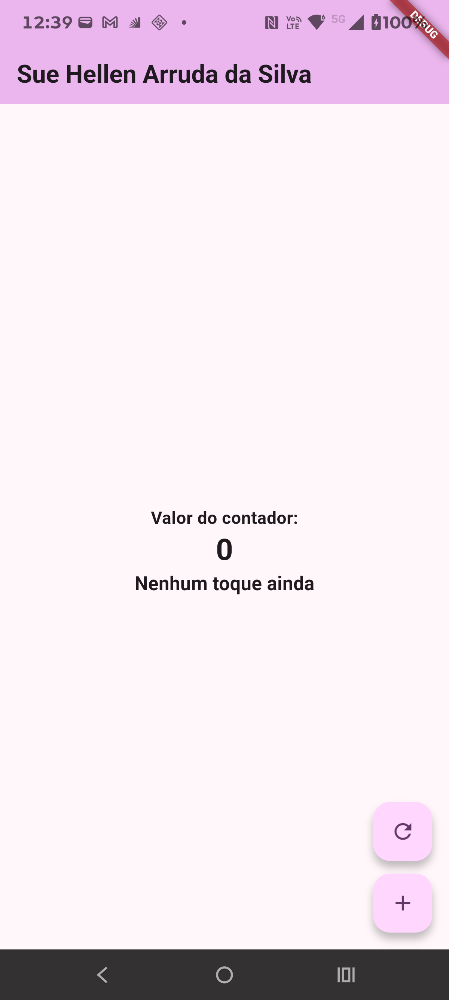
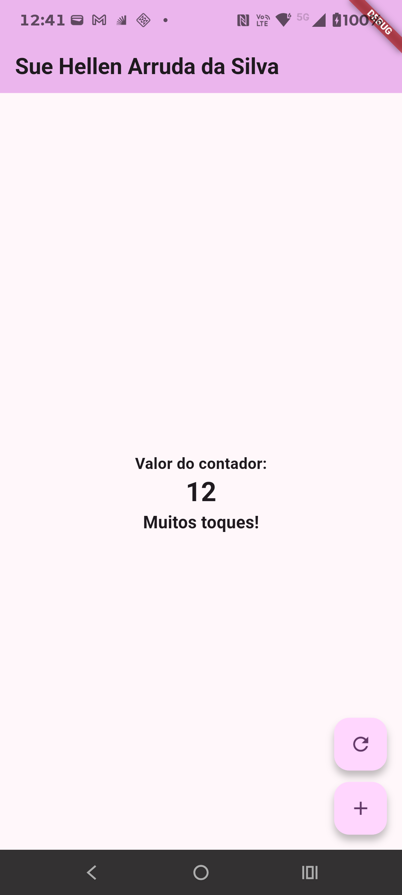
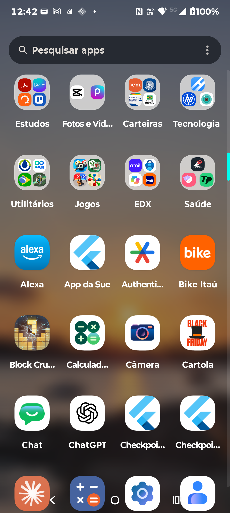

# Respostas — Aula 02: Instalação e Configuração do Ambiente

**Aluna:** Sue Hellen Arruda da Silva
**Disciplina:** Desenvolvimento Mobile (`F105880`) — UNIT 2026

---

## Parte A — Ambiente verde

### A1 — `flutter doctor -v`

```
[√] Flutter (Channel stable, 3.47.9, on Microsoft Windows [versÆo 10.0.26300.9974], locale pt-BR) [544ms]
    • Flutter version 3.47.9 on channel stable at C:\dev\flutter
    • Upstream repository https://github.com/flutter/flutter.git
    • Framework revision c197ca5199 (3 weeks ago), 2026-10-29 10:10:20 -0400
    • Engine revision 89c39edfdf
    • Dart version 3.13.7
    • DevTools version 2.60.0
    • Feature flags: enable-web, enable-linux-desktop, enable-macos-desktop, enable-windows-desktop, enable-android,
      enable-ios, cli-animations, enable-native-assets, enable-record-use, enable-swift-package-manager,
      omit-legacy-version-file, enable-lldb-debugging, enable-uiscene-migration

[√] Windows Version (Windows 11 or higher, 26H2, 2009) [2,4s]

[√] Android toolchain - develop for Android devices (Android SDK version 36.0.0) [1.110ms]
    • Android SDK at C:\Users\suear\AppData\Local\Android\sdk
    • Emulator version 37.1.11.0 (build_id 15917651) (CL:N/A)
    • Platform android-37.0, build-tools 36.0.0
    • Java binary at: C:\Program Files\Android\Android Studio\jbr\bin\java
      This is the JDK bundled with the latest Android Studio installation on this machine.
      To manually set the JDK path, use: `flutter config --jdk-dir="path/to/jdk"`.
    • Java version OpenJDK Runtime Environment (build 25.0.2+-15348964-b329.117)
    • All Android licenses accepted.

[√] Chrome - develop for the web [19ms]
    • Chrome at C:\Program Files\Google\Chrome\Application\chrome.exe

[X] Visual Studio - develop Windows apps [18ms]
    X Visual Studio not installed; this is necessary to develop Windows apps.
      Download at https://visualstudio.microsoft.com/downloads/.
      Please install the "Desktop development with C++" workload, including all of its default components

[√] Connected device (4 available) [1.229ms]
    • motorola edge 50 neo (mobile) • 0088874915 • android-arm64  • Android 16 (API 36)
    • Windows (desktop)             • windows    • windows-x64    • Microsoft Windows [versÆo 10.0.26300.9974]
    • Chrome (web)                  • chrome     • web-javascript • Google Chrome 157.0.8103.80
    • Edge (web)                    • edge       • web-javascript • Microsoft Edge 157.0.4341.46

[√] Network resources [1.099ms]
    • All expected network resources are available.

! Doctor found issues in 1 category.
```

Itens obrigatórios:

- [x] `[✓] Flutter`
- [x] `[✓] Android toolchain`
- [x] `[✓] Network resources`
- [x] `[✓] Connected device` (motorola edge 50 neo, conectado por cabo USB)

O único `[X]` é o **Visual Studio**, que só é necessário para criar apps de
Windows — a lista permite deixá-lo em ✗.



### A2 — `flutter --version` e `flutter devices`

```
Flutter 3.47.9 • channel stable • https://github.com/flutter/flutter.git
Framework • revision c197ca5199 (3 weeks ago) • 2026-10-29 10:10:20 -0400
Engine • hash 9e025265bef30b838c0c1b68cad19decf97048f2 (revision 89c39edfdf) (24 days ago) • 2026-10-27 19:51:20.000Z
Tools • Dart 3.13.7 • DevTools 2.60.0
```

```
Found 4 connected devices:
  motorola edge 50 neo (mobile) • 0088874915 • android-arm64  • Android 16 (API 36)
  Windows (desktop)             • windows    • windows-x64    • Microsoft Windows [versÆo 10.0.26300.9974]
  Chrome (web)                  • chrome     • web-javascript • Google Chrome 157.0.8103.80
  Edge (web)                    • edge       • web-javascript • Microsoft Edge 157.0.4341.46
```

App rodando no celular:



---

## Parte B — Primeiro app personalizado (`meu_primeiro_app/`)

| # | Alteração | Onde | Print |
|---|---|---|---|
| B1 | Título da `AppBar` = "Sue Hellen Arruda da Silva" | `lib/main.dart` (`home: MyHomePage(title: ...)`) |  |
| B2 | Tema roxo: `ColorScheme.fromSeed(seedColor: Colors.purple)` | `lib/main.dart` (`ThemeData`) |  |
| B3 | Contador de 3 em 3: `_counter += 3` | `_incrementCounter()` |  |
| B4 | Botão que zera, com `heroTag` diferente em cada `FloatingActionButton` dentro de uma `Column` | `_resetCounter()` e `floatingActionButton` |  |
| B5 | Texto muda: "Nenhum toque ainda" (0), "Poucos toques" (até 9), "Muitos toques!" (10+) | `if/else` no `build`, guardado na variável `mensagem` |  |
| B6 | Nome na gaveta = "App da Sue" | `android/app/src/main/AndroidManifest.xml` (`android:label`) |  |

Qualidade: `dart format .` aplicado, `flutter analyze` → `No issues found!`,
nenhum `print()` no código. O teste do template foi atualizado para o novo
comportamento (contador de 3 em 3, mensagem e botão de zerar) e passa com
`flutter test`.

---

## Parte C — Experimentos com Hot Reload

**C1 — Apertei o botão 5× e mudei um texto.**
O texto mudou de "Valor do contador:" para "Contador:" e o contador **não
zerou** (continuou em 15). O hot reload troca o código e redesenha a tela, mas
mantém o objeto de estado (`_MyHomePageState`) vivo — por isso o valor que já
estava na memória foi preservado.

**C2 — Mudei a cor do tema.**
Funcionou só com `r` (hot reload): a cor passou de roxo para verde-azulado
(teal). A cor é lida dentro do `build`, que roda de novo no hot reload.

**C3 — Mudei o valor inicial do contador de `0` para `100`.**
Com `r`, o número continuou como estava (no meu teste, ficou em **9**): o valor
inicial só é usado quando o estado é criado, e o hot reload não cria o estado de
novo. Com `R` (hot
restart), o app reiniciou do zero e o contador apareceu com **100**.

**C4 — Coloquei `print('oi')` dentro do `main()`.**
Com `r`, nada apareceu: o hot reload não executa o `main()` de novo. Com `R`, o
`main()` rodou outra vez e a mensagem apareceu **no terminal** do `flutter run`
(não no celular), na linha `I/flutter (13042): oi`.

**C5 — Rodei `flutter pub add intl` com o app rodando.**
O terminal mostrou `+ intl 0.20.3` e `Changed 1 dependency!`: o pacote foi
baixado e adicionado ao `pubspec.yaml`. O app que estava rodando não mudou nada
(o `r` seguinte mostrou `Reloaded 0 of 754 libraries`), porque o pacote ainda
não era usado no código. Para usar um pacote novo, o mais seguro é parar o app
(`q`) e rodar `flutter run` de novo — principalmente se o pacote tiver código
nativo. Depois do experimento, removi o pacote com `flutter pub remove intl`.

**C6 — Minha regra.**
O hot reload (`r`) basta quando eu mudo a aparência ou o comportamento da tela,
como textos, cores e o que acontece ao tocar num botão: ele aplica a mudança e
mantém os dados que já estavam na tela (o contador continuou em 15). Quando mudo
algo que só roda quando o app começa, como o valor inicial de uma variável ou o
código dentro do `main()`, preciso do hot restart (`R`), que reinicia o app e
zera o estado. Já quando adiciono um pacote novo ao projeto, o mais seguro é
parar o app e rodar `flutter run` de novo.

---

## Parte D — Diário de bordo do ambiente

**Minha máquina:** Windows 11 (versão 26H2), Flutter 3.47.9 (stable), Dart
3.13.7, Android Studio com Android SDK 36 e JDK embutido. Testes feitos em
**celular físico**: motorola edge 50 neo, Android 16 (API 36), ligado por cabo
USB com depuração USB ativada.

### Problema 1

**Sistema operacional:** Windows 11
**Momento:** ao rodar o app no celular

**Mensagem de erro (copiada, não digitada):**
```
No supported devices found with name or id matching '0088874915'.

The following devices were found:
Windows (desktop) • windows • windows-x64    • Microsoft Windows [versÆo 10.0.26300.9974]
Chrome (web)      • chrome  • web-javascript • Google Chrome 157.0.8103.80
Edge (web)        • edge    • web-javascript • Microsoft Edge 157.0.4341.46
```

**O que eu tentei que NÃO funcionou:**
- rodar o `flutter run` de novo, sem mexer no celular

**O que resolveu:**
- reiniciar o servidor do adb: `adb kill-server` e depois `adb start-server`
- reconectar o cabo, desbloquear o celular e aceitar a depuração USB
- conferir com `adb devices` que o celular apareceu como `device`

**Tempo gasto:** ~10 min
**Como eu descobri:** slide da Aula 02 (Etapa 2, "Não aparece?")

### Problema 2

**Sistema operacional:** Windows 11
**Momento:** com o app rodando pelo `flutter run`

**Mensagem de erro (copiada, não digitada):**
```
Lost connection to device.
```

**O que eu tentei que NÃO funcionou:**
- apertar `r` / `R` na mesma janela (o `flutter run` já tinha se desconectado)

**O que resolveu:**
- conferir `adb devices`, reconectar o cabo e rodar `flutter run` de novo
- não fechar o app pelos "apps recentes" do celular enquanto o `flutter run`
  está ligado (fechar o app também encerra a conexão)

**Tempo gasto:** ~5 min (aconteceu algumas vezes)
**Como eu descobri:** lendo a mensagem e testando com `adb devices`

### Problema 3

**Sistema operacional:** Windows 11
**Momento:** ao rodar `flutter doctor -v` dentro da pasta de um projeto

**Mensagem de erro (copiada, não digitada):**
```
Unhandled exception:
Error on line 43, column 5: Duplicate mapping key.
   ╷
43 │     sdk: flutter
   │     ^^^
```

**O que eu tentei que NÃO funcionou:**
- rodar o `flutter devices` (deu o mesmo erro)

**O que resolveu:**
- o `flutter` lê o `pubspec.yaml` da pasta atual, e esse arquivo estava com um
  trecho duplicado. Vi a diferença com `git diff pubspec.yaml` e voltei o
  arquivo para a última versão boa com `git checkout -- pubspec.yaml`

**Tempo gasto:** ~10 min
**Como eu descobri:** a mensagem apontava a linha 43 do `pubspec.yaml`; o
`git diff` mostrou a linha repetida

### Problema 4

**Sistema operacional:** Windows 11
**Momento:** ao rodar `flutter pub add intl` (experimento C5)

**Mensagem de erro (copiada, não digitada):**
```
Expected to find project root in current working directory.
```

**O que eu tentei que NÃO funcionou:**
- rodar o comando de novo na mesma pasta

**O que resolveu:**
- entrar na pasta do projeto (`cd meu_primeiro_app`), onde fica o
  `pubspec.yaml`, e rodar o comando lá

**Tempo gasto:** ~2 min
**Como eu descobri:** lendo a mensagem: "project root" é a pasta que tem o
`pubspec.yaml`

### D2

**(a)** O passo mais confuso foi fazer o computador reconhecer o celular: às
vezes ele não aparecia na lista de dispositivos, sem uma mensagem clara do
motivo. Teria ajudado um passo a passo com a ordem do que conferir (cabo,
depuração USB, aceitar o aviso no celular e `adb kill-server`).

**(b)** Usei o celular físico porque é mais rápido do que o emulador e não deixa
o notebook lento. Além disso, mostra o app como ele vai ficar de verdade no
aparelho do usuário.

**(c)** O primeiro `flutter run` levou cerca de **2 minutos** (o Gradle levou
120 s para montar o app pela primeira vez). Os seguintes levaram entre **8 e
14 segundos**, porque o Gradle reaproveita o que já tinha compilado.
