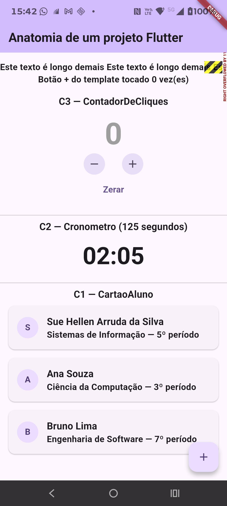
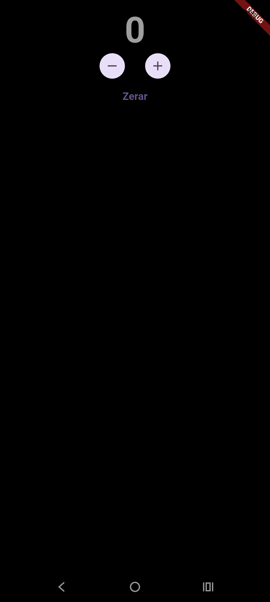
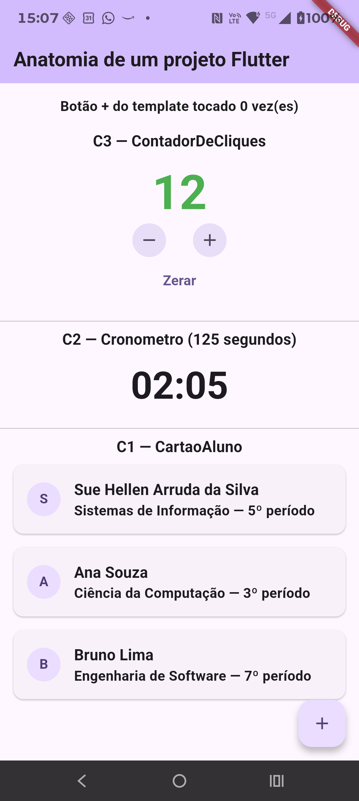

# Respostas — Aula 03: Anatomia de um Projeto Flutter

**Aluna:** Sue Hellen Arruda da Silva
**Disciplina:** Desenvolvimento Mobile (`F105880`) — UNIT 2026

Projeto: `anatomia_app/` (criado com
`flutter create --org br.edu.unit --platforms=android anatomia_app`).

- `flutter analyze` → `No issues found!`
- `flutter test` → `+4: All tests passed!` (um teste para o app e um para cada widget da Parte C)
- `dart format .` aplicado

---

## Parte A — Anatomia comentada

### A1

Os comentários estão no próprio `anatomia_app/lib/main.dart`, acima de cada uma
das linhas pedidas (`void main()`, `runApp(...)`, `class MyApp`, `build`,
`MaterialApp`, `home:`, `class MyHomePage`, `final String title`,
`createState()`, `_MyHomePageState`, `int _counter = 0`, `setState`,
`appBar: AppBar(...)` e `onPressed: _incrementCounter`).

### A2

**1. Por que um `StatefulWidget` precisa de duas classes?**
Porque são duas coisas com "tempos de vida" diferentes. O widget
(`MyHomePage`) é só uma descrição imutável: o Flutter joga fora e cria outro
toda vez que a tela é reconstruída, o que é barato. O objeto de estado
(`_MyHomePageState`) é criado uma vez só e continua vivo entre as
reconstruções — é ele que guarda os dados que mudam. Se tudo ficasse numa
classe só, os dados seriam perdidos a cada reconstrução.

**2. Por que `_counter` fica na classe de estado e `title` na classe do widget?**
`_counter` muda enquanto a tela está aberta (a cada toque), então precisa
morar no objeto que sobrevive às reconstruções: o estado. `title` vem de fora
(de quem criou a tela, no `home:`) e não muda dentro dela — é configuração,
por isso é `final` e fica no widget.

**3. O que o `_` no início de `_MyHomePageState` e `_counter` significa em Dart?**
Significa **privado**: o nome só pode ser usado dentro do mesmo arquivo
(biblioteca). Outros arquivos do projeto não enxergam `_counter` nem
`_MyHomePageState`, o que protege esses detalhes internos de serem mexidos de
fora.

**4. Quantas vezes o `build()` é chamado? Que código nunca deve estar nele?**
Não dá para saber — muitas vezes. Ele roda quando o widget entra na tela, a
cada `setState`, quando o pai é reconstruído, quando algo de que ele depende
muda (tema, tamanho da tela, rotação, teclado aparecendo) e em todo hot reload.
Por isso o `build` deve só **descrever a tela**. Nunca colocar nele: chamadas de
rede, leitura de arquivo ou banco de dados, criação de timers ou controllers,
cálculos pesados e chamadas a `setState`. Como ele roda várias vezes, essas
coisas seriam repetidas sem necessidade, deixariam o app lento e, no caso do
`setState`, criariam um laço infinito de reconstruções.

---

## Parte B — Catálogo de erros

### B1 — `onPressed` com parênteses

**Mensagem completa (copiada):**
```
error - This expression has a type of 'void' so its value can't be used. Try checking to see if you're using the
       correct API; there might be a function or call that returns void you didn't expect. Also check type parameters
       and variables which might also be void - lib\main.dart:136:20 - use_of_void_result
```

**Onde apareceu:** `lib/main.dart`, linha 136 — no `flutter analyze` (e
sublinhado no editor), antes de rodar.

**O que a mensagem está dizendo, com minhas palavras:**
Com os parênteses, `_incrementCounter()` **executa** a função na hora, e o
`onPressed` recebe o **resultado** dela. Como a função não devolve nada
(`void`), o `onPressed` estaria recebendo "nada" em vez de uma função para
chamar depois, no toque.

**Como corrigi:** tirei os parênteses: `onPressed: _incrementCounter`. Assim eu
entrego a função, e o botão chama quando for tocado.

> Observação: na minha versão do Flutter (3.47.9) a mensagem é diferente da do
> slide (`The argument type 'void' can't be assigned to the parameter type
> 'void Function()?'`), mas o problema é o mesmo.

### B2 — Tirar o `setState`

**Mensagem completa (copiada):**
```
(nenhuma — o código compilou, rodou e o terminal não mostrou erro)
```

**Onde apareceu:** em lugar nenhum. Troquei o corpo de `_incrementCounter` por
apenas `_counter++;`, rodei com `R` e toquei 5 vezes no botão `+` flutuante.

**O que aconteceu:**
- o texto "Botão + do template tocado **0** vez(es)" **não mudou**;
- **não apareceu erro** no terminal;
- quando apertei `r` (hot reload), o número **pulou para 5** de repente.

**O que isso mostra, com minhas palavras:**
O `_counter` estava sendo somado na memória o tempo todo, mas ninguém avisou
o Flutter que era preciso redesenhar a tela. O `setState` é exatamente esse
aviso. O hot reload chama o `build` de novo, e por isso o valor que já estava
na memória (5) apareceu de uma vez.

**Como corrigi:** voltei com o `setState(() { _counter++; });`.

**Por que esse bug é mais perigoso que um erro de compilação?**
Porque ele é **silencioso**: compila, passa no `flutter analyze`, o app abre e
nada avisa que tem algo errado. Um erro de compilação aparece na hora para o
desenvolvedor; esse aqui só é descoberto quando alguém usa o app e percebe que
o botão "não funciona" — muitas vezes o próprio usuário.

**Como detectar antes do usuário reclamar?**
Com um **teste de widget** que toca no botão e confere se o número mostrado
mudou (`tester.tap(...)`, `tester.pump()`, `expect(find.text('1'), ...)`). O
teste do `ContadorDeCliques` neste projeto faz exatamente isso: se alguém
apagar o `setState`, o teste falha. Também ajuda testar o app manualmente a
cada mudança.

### B3 — `Text(_counter)` em vez de `Text('$_counter')`

**Mensagem completa (copiada):**
```
error - The argument type 'int' can't be assigned to the parameter type 'String'.  - lib\main.dart:92:13 -
       argument_type_not_assignable
```

**Onde apareceu:** `lib/main.dart`, linha 92 — no `flutter analyze`, antes de
rodar.

**O que a mensagem está dizendo, com minhas palavras:**
O `Text` só aceita texto (`String`), e `_counter` é um número inteiro (`int`).
O Dart não converte um no outro sozinho.

**Como corrigi:** transformei o número em texto com interpolação:
`Text('$_counter')` (ou `Text(_counter.toString())`).

### B4 — `children: [...]` dentro de um `Center`

**Mensagem completa (copiada):**
```
error - The named parameter 'padding' isn't defined. Try correcting the name to an existing named parameter's name, or
       defining a named parameter with the name 'padding' - lib\main.dart:89:9 - undefined_named_parameter
error - The named parameter 'children' isn't defined. Try correcting the name to an existing named parameter's name,
       or defining a named parameter with the name 'children' - lib\main.dart:90:9 - undefined_named_parameter
```

**Onde apareceu:** `lib/main.dart`, linhas 89 e 90 — no `flutter analyze`,
antes de rodar. (Troquei o `ListView` do `body` por `Center`; como o `ListView`
também tinha `padding`, apareceu um erro a mais.)

**O que a mensagem está dizendo, com minhas palavras:**
O `Center` não tem um parâmetro chamado `children`. Ele só aceita **um** filho,
em `child`. Quem recebe uma lista de filhos (`children`) são widgets como
`Column`, `Row` e `ListView`.

**Como corrigi:** voltei a usar `ListView` (que aceita `children`). Outra opção
seria `Center(child: Column(children: [...]))`.

### B5 — `Row` com um `Text` enorme, sem `Expanded`

**Mensagem completa (copiada):**
```
══╡ EXCEPTION CAUGHT BY RENDERING LIBRARY ╞═════════════════════════════════════════════════════════
The following assertion was thrown during layout:
A RenderFlex overflowed by 1176 pixels on the right.

The relevant error-causing widget was:
  Row
  Row:file:///C:/projetos/desenvolvimento-mobile-unit-2026-exercicios/exercicios/aula03/anatomia_app/lib/main.dart:91:21

The overflowing RenderFlex has an orientation of Axis.horizontal.
The edge of the RenderFlex that is overflowing has been marked in the rendering with a yellow and
black striped pattern. This is usually caused by the contents being too big for the RenderFlex.
Consider applying a flex factor (e.g. using an Expanded widget) to force the children of the
RenderFlex to fit within the available space instead of being sized to their natural size.
```

**Onde apareceu:** `lib/main.dart`, linha 91 — **só com o app rodando**, no
terminal do `flutter run`. No celular apareceu a faixa amarela e preta com o
aviso "RIGHT OVERFLOWED BY 1176 PIXELS".



**O que a mensagem está dizendo, com minhas palavras:**
A `Row` deixa cada filho ter o tamanho que quiser. O texto queria uma linha só,
muito maior que a largura da tela, e passou 1176 pixels da borda direita. O
próprio Flutter sugere a solução: usar `Expanded`.

**Como corrigi:** envolvi o texto em `Expanded`:
`Row(children: [Expanded(child: Text(...))])`. Assim o texto fica limitado à
largura que sobra e quebra em várias linhas.

### B6 — Trocar o `Scaffold` por `Center` direto no `home:`

**Mensagem completa (copiada):**
```
(nenhuma mensagem nova no terminal — o problema apareceu só na tela)
```

**Onde apareceu:** no celular. Troquei o `home:` por
`home: const Center(child: ContadorDeCliques())`, ou seja, uma tela sem
`Scaffold`.



**O que aconteceu, com minhas palavras:**
A tela ficou **toda preta**, sem a barra do topo (`AppBar`), sem a cor de fundo
do tema e com o conteúdo grudado no topo, por baixo da barra de status. O
`Scaffold` é quem monta a "estrutura" da tela: fundo com a cor do tema,
`AppBar`, `body`, botão flutuante e a área onde aparecem as `SnackBar`. Sem
ele, sobra só o widget solto em cima de um fundo vazio. Se a tela tivesse um
`FloatingActionButton` ou tentasse mostrar uma `SnackBar`, o Flutter também
reclamaria de não encontrar um `Scaffold`/`Material` acima na árvore.

**Como corrigi:** voltei o `home:` para `const MyHomePage(...)`, que tem o
`Scaffold`.

---

## Parte C — Criando widgets

Cada widget está em seu próprio arquivo, em `anatomia_app/lib/widgets/`:

| Widget | Arquivo | Tipo | Print |
|---|---|---|---|
| `CartaoAluno` | `cartao_aluno.dart` | Stateless |  |
| `Cronometro` | `cronometro.dart` | Stateless |  |
| `ContadorDeCliques` | `contador_de_cliques.dart` | Stateful |  |

Tela completa:



- **C1:** construtor `const`, campos `final`, `required` em `nome` e `curso`,
  `periodo` opcional com padrão 5; estilos do texto vêm de `Theme.of(context)`.
- **C2:** `125` → `02:05`, usando `~/` (divisão inteira) para os minutos, `%`
  para os segundos e `padLeft(2, '0')`.
- **C3:** botões − e +, não fica negativo (o − não faz nada em 0), cor cinza
  em 0, azul de 1 a 9 e verde de 10 em diante, botão "Zerar".

**Por que o `ContadorDeCliques` precisa ser Stateful? Qual critério se aplica?**
O critério da aula é a pergunta: **"este widget precisa lembrar de alguma coisa
que muda enquanto ele está na tela?"** No contador, sim: o número muda a cada
toque e precisa ser lembrado entre um desenho e outro, e é o próprio widget que
muda esse valor. Por isso o valor mora num `State` e cada mudança passa por
`setState`. Já o `CartaoAluno` e o `Cronometro` só mostram os dados que
recebem de fora e não mudam sozinhos — por isso são Stateless.

---

## Parte D — Árvore de widgets

### D1

```
Scaffold
├── appBar: AppBar
│   ├── title: Text('Perfil')
│   └── actions:
│       └── IconButton
│           └── icon: Icon(Icons.edit)
├── body: SingleChildScrollView
│   └── child: Column
│       ├── SizedBox (height: 24)
│       ├── CircleAvatar (radius: 48)
│       │   └── child: Icon(Icons.person)
│       ├── SizedBox (height: 16)
│       ├── Text('Ana Souza')
│       ├── Text('Sistemas de Informação')
│       ├── Divider
│       └── Padding (all: 16)
│           └── child: Row
│               ├── Expanded
│               │   └── child: Text('Período')
│               └── Text('5º')
└── floatingActionButton: FloatingActionButton
    └── child: Icon(Icons.share)
```

### D2

**(a) `child:` x `children:`**
- Recebem **um filho** (`child:`): `SingleChildScrollView`, `CircleAvatar`,
  `Padding`, `Expanded` e `FloatingActionButton`. (O `AppBar` também recebe um
  widget só em `title:`, e o `IconButton` em `icon:`.)
- Recebem **uma lista** (`children:`): `Column` e `Row`. (O `AppBar` também
  recebe uma lista em `actions:`.)

**(b) Função do `Expanded` dentro da `Row`**
Ele faz o `Text('Período')` ocupar **todo o espaço que sobra** na linha, o que
empurra o `Text('5º')` para a borda direita (como uma tabela de
"rótulo ... valor"). Sem ele, os dois textos ficariam colados no começo da
linha. E se o texto fosse muito longo, ele passaria da borda da tela e daria o
erro de overflow com a faixa amarela e preta — o mesmo do meu B5. Com o
`Expanded`, o texto fica limitado à largura disponível e quebra em várias
linhas.

**(c) Por que o `SingleChildScrollView` envolve a `Column`?**
Porque a `Column` não rola: se o conteúdo for mais alto que a tela, ele é
cortado. Isso acontece em celular pequeno, com o aparelho deitado, com fonte
grande nas configurações de acessibilidade ou com o teclado aberto. O
`SingleChildScrollView` deixa a tela rolar e evita o erro
`A RenderFlex overflowed by ... pixels on the bottom`.

**(d) O que seria "propriedade" em CSS/XML em vez de widget**
- `Padding` → a propriedade `padding: 16px`;
- `SizedBox` (os espaços de 24 e 16) → `margin` ou `gap` entre os elementos;
- `Expanded` → `flex: 1` num container `display: flex`;
- `SingleChildScrollView` → `overflow-y: auto`;
- `Divider` → uma `border-bottom` (ou a tag `<hr>`).

No Flutter tudo isso é widget, encaixado na árvore; no CSS seriam atributos do
próprio elemento.
