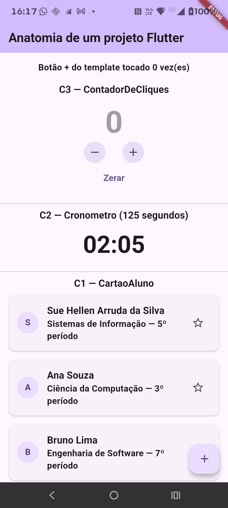
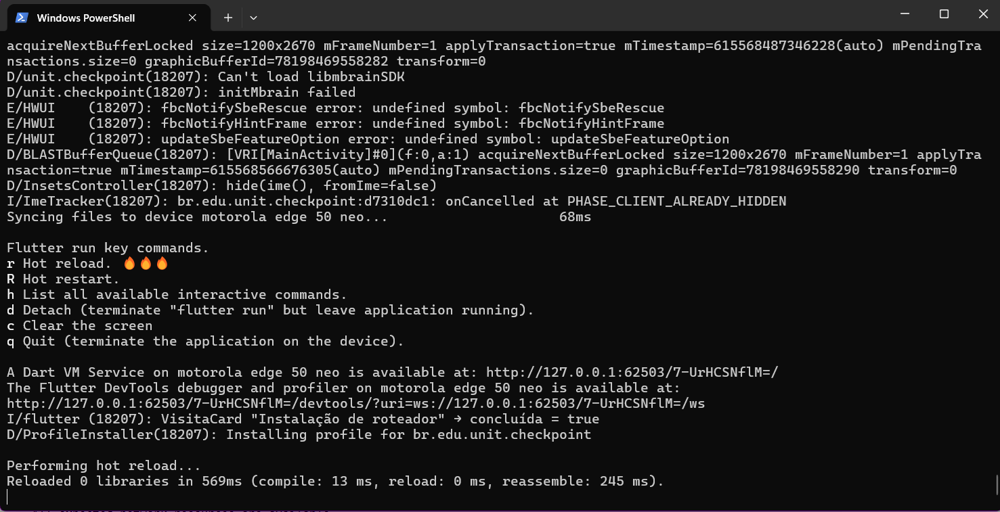
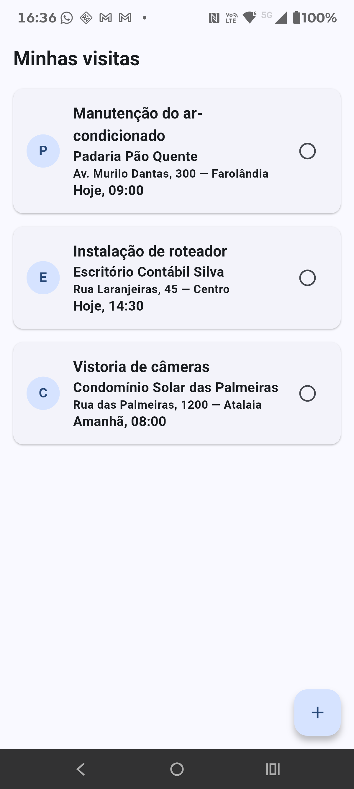

# Aula 04 — Android Debug Bridge (adb)

**Aluna:** Sue Hellen Arruda da Silva (`suehellenarruda`)
**Ambiente:** Windows 11 + PowerShell 5.1, Flutter 3.47.9 / Dart 3.13.7
**Projeto usado nas Partes B e C:** `anatomia_app` (Aula 03), em uma cópia de trabalho fora do repositório

> As saídas completas de cada rodada de comandos estão em [`logs/`](logs/).
> Abaixo estão os trechos relevantes de cada item. No PowerShell 5.1 os acentos
> aparecem trocados nos transcripts, mas isso é só exibição do console.
>
> Observação sobre o terminal: no PowerShell, o `>` regrava a saída como texto
> UTF-16 e estraga arquivos binários. Por isso os comandos com redirecionamento
> (`screencap`) foram executados via `cmd /c "..."`, que faz o mesmo que o `>` do bash.

---

## Parte A — Ficha técnica do aparelho

### A1

```text
PS> adb version
Android Debug Bridge version 1.0.41
Version 37.0.1-15733141

PS> adb devices -l
List of devices attached
0088874915             device product:vienna_g_sys model:motorola_edge_50_neo device:vienna

PS> adb shell getprop ro.product.model
motorola edge 50 neo

PS> adb shell getprop ro.product.manufacturer
motorola

PS> adb shell getprop ro.build.version.release
16

PS> adb shell getprop ro.build.version.sdk
36

PS> adb shell wm size
Physical size: 1200x2670

PS> adb shell wm density
Physical density: 450
```

(Saída completa em `logs/aula04-rodada1b.txt`.)

| Item | Valor |
|---|---|
| Modelo | motorola edge 50 neo |
| Fabricante | motorola |
| Android | 16 |
| Nível de API | 36 |
| Resolução (px) | 1200 x 2670 |
| Densidade (dpi) | 450 |

### A2

```text
largura_dp = largura_px / (dpi / 160)
           = 1200 / (450 / 160)
           = 1200 / 2,8125
           ≈ 426,7 dp   →  ~427 dp
```

**(a) Por que 160?** Porque 160 dpi é a densidade de referência do Android, chamada
**mdpi**, que era a densidade dos primeiros aparelhos. Nessa densidade, **1 dp = 1 px**.
Todas as outras densidades são medidas em relação a ela. No meu aparelho, 450/160 = 2,8125,
ou seja, cada dp ocupa cerca de 2,8 pixels físicos.

**(b) Colegas:**

Não consegui consultar dois colegas a tempo da entrega. Para **não inventar números**,
comparei com o aparelho de exemplo do próprio Lab 04 (Samsung SM-A515F):

| Aparelho | Resolução | Densidade | Largura em dp |
|---|---|---|---|
| **Eu**: motorola edge 50 neo | 1200 x 2670 | 450 dpi | 1200 / 2,8125 ≈ **427** |
| Exemplo do lab: SM-A515F | 1080 x 2400 | 420 dpi | 1080 / 2,625 ≈ **411** |

Os números ficaram **próximos** (427 e 411 dp), mesmo com 120 px de diferença na
largura e densidades diferentes. O lab indica que a maioria dos celulares fica entre
**360 e 430 dp**. Isso mostra para que serve o **dp**: é uma unidade **independente da
densidade**, que mede o tamanho **visual** na tela e não a quantidade de pixels. Um
layout feito em dp fica com o mesmo tamanho aparente em qualquer celular, e o Flutter
(que usa dp como unidade lógica) converte para pixels multiplicando pelo fator de densidade.

**(c) `Container(width: 400)`:** no meu aparelho **cabe**, porque 400 dp < 427 dp e ainda
sobram cerca de 27 dp. No aparelho do exemplo (411 dp) também **cabe**, mas com pouca folga. Já num celular
menor, de **360 dp** (a menor largura comum), **não cabe**: faltariam 40 dp. Numa `Row`,
o Flutter mostraria o aviso de **overflow** (a faixa amarela e preta, `RenderFlex overflowed`). Por isso não se fixa largura em dp para
ocupar a tela. O certo é usar layouts flexíveis (`Expanded`, `double.infinity`,
`MediaQuery`, `LayoutBuilder`).

---

## Parte B — Ciclo completo de vida do app

### B1

Trechos da sequência executada no `anatomia_app` (`applicationId` = `br.edu.unit.anatomia_app`).
Como `grep` não existe no PowerShell, usei `findstr`. Para o `ls -lh`, usei `dir`.

```text
PS> flutter build apk --debug
✓ Built build\app\outputs\flutter-apk\app-debug.apk

PS> dir build\app\outputs\flutter-apk\
app-debug.apk        150.558.944 bytes

PS> adb install -r build\app\outputs\flutter-apk\app-debug.apk
Success

PS> adb shell pm list packages | findstr unit
package:br.edu.unit.anatomia_app

PS> adb shell monkey -p br.edu.unit.anatomia_app 1
Events injected: 1

PS> cmd /c "adb exec-out screencap -p > prints\app-instalado.png"
(print salvo em prints/app-instalado.png)

PS> adb shell pm clear br.edu.unit.anatomia_app
Success

PS> adb uninstall br.edu.unit.anatomia_app
Success
```

(Saída completa, com todas as linhas, em `logs/aula04-rodada1b.txt`.)



O que cada passo faz:
- `install -r` instala por cima e mantém os dados.
- `pm list packages` confirma que o pacote está no aparelho.
- `monkey -p … 1` abre o app sem precisar saber o nome da Activity.
- `pm clear` apaga os dados, como "Limpar armazenamento".
- `uninstall` remove o app.

### B2

| Build | Tamanho |
|---|---|
| `app-debug.apk` | 150.558.944 bytes ≈ **143,6 MB** |
| `app-release.apk` | 45.552.440 bytes ≈ **43,4 MB** |

O debug é cerca de **3,3 vezes maior**. Isso acontece porque ele é feito para
**desenvolver**, e não para distribuir:

- **Debug (JIT):** leva o código Dart em formato **kernel/bytecode**, junto com a
  **Dart VM completa com compilador JIT**, o suporte a **hot reload**, o **VM Service**
  usado pelo DevTools e o depurador, os **asserts** e as mensagens de erro detalhadas.
  Ele também inclui bibliotecas para **várias arquiteturas** de CPU.
- **Release (AOT):** o Dart já vem **compilado para código de máquina nativo**
  (Ahead-Of-Time), sem compilador JIT e sem ferramentas de depuração. Os asserts são
  removidos e o código não usado é descartado (*tree shaking*, inclusive nos ícones).

Resumindo: o debug carrega as **ferramentas** (JIT, hot reload, depuração), e o
release carrega só o **código pronto**. É por isso que o release também roda mais
rápido.

### B3

```text
PS> cmd /c "adb exec-out screencap -p > prints\correto.png"
PS> cmd /c "adb shell screencap -p > prints\corrompido.png"
PS> dir prints\correto.png prints\corrompido.png
correto.png        200.666 bytes
corrompido.png     201.401 bytes
```

- **`correto.png` abre normalmente.**
- **`corrompido.png` não abre**: o visualizador diz que o arquivo é inválido.

A diferença é de **735 bytes a mais** no corrompido.

**Causa:** o `adb shell` abre um **terminal (PTY)** no aparelho, e o terminal
trata a saída como **texto**, trocando toda quebra de linha `\n` (byte `0x0A`) por `\r\n`
(`0x0D 0x0A`). Uma imagem PNG é **binária** e tem vários bytes `0x0A` no meio,
inclusive na assinatura do cabeçalho (`89 50 4E 47 0D 0A 1A 0A`). Cada um deles
ganhou um `0x0D` extra, o que deu 735 bytes a mais e um arquivo quebrado.
O `adb exec-out` usa um canal **cru**, sem terminal, e por isso entrega os bytes
exatamente como saíram.


---

## Parte C — Diagnóstico por logcat

Em cada caso usei duas janelas: uma com `adb logcat -c` seguido de `adb logcat *:E`
e outra com `flutter run` (ou o app aberto via `adb`). Para o PowerShell, filtrei com
`Select-String` em vez de `grep`.

### C1 — Exceção em callback de botão

O código foi alterado assim:

```dart
void _incrementCounter() {
  if (_counter == 3) {
    throw Exception('Erro proposital C1');
  }
  setState(() {
    _counter++;
  });
}
```

Toquei 5 vezes no botão **+**. Saída do `flutter run`:

```text
══╡ EXCEPTION CAUGHT BY GESTURE ╞═══════════════════════════════════════════════════════════════════
The following _Exception was thrown while handling a gesture:
Exception: Erro proposital C1

When the exception was thrown, this was the stack:
#0      _MyHomePageState._incrementCounter (package:anatomia_app/main.dart:72:7)
#1      _InkResponseState.handleTap (package:flutter/src/material/ink_well.dart:1224:21)
#2      GestureRecognizer.invokeCallback (package:flutter/src/gestures/recognizer.dart:362:24)
#3      TapGestureRecognizer.handleTapUp (package:flutter/src/gestures/tap.dart:758:11)
#4      BaseTapGestureRecognizer._checkUp (package:flutter/src/gestures/tap.dart:383:5)
#5      BaseTapGestureRecognizer.acceptGesture (package:flutter/src/gestures/tap.dart:353:7)
#6      GestureArenaManager.sweep (package:flutter/src/gestures/arena.dart:173:27)
#7      GestureBinding.handleEvent (package:flutter/src/gestures/binding.dart:542:20)
...
#16     _dispatchPointerDataPacket (dart:ui/hooks.dart:374:31)

Handler: "onTap"
Recognizer:
  TapGestureRecognizer#45214
════════════════════════════════════════════════════════════════════════════════════════════════════

Another exception was thrown: Exception: Erro proposital C1
Another exception was thrown: Exception: Erro proposital C1
```

Saída do `adb logcat *:E | Select-String "flutter|Erro proposital"` durante os toques:
**nenhuma linha nova sobre o anatomia_app**. A única linha que apareceu na janela,
`E FlutterGeolocator`, é de **outro app** do aparelho (outro PID) e foi registrada antes
do teste.

| O que registrar | Resultado |
|---|---|
| Linha do log | `Exception: Erro proposital C1` (bloco `EXCEPTION CAUGHT BY GESTURE`) |
| Arquivo e linha | `package:anatomia_app/main.dart:72:7`, dentro de `_incrementCounter` |
| O app fechou? | **Não.** Continuou aberto e respondendo. |

O contador subiu para 1, 2 e 3 e **parou no 3**. A partir do 4º toque, o `throw`
acontece **antes** do `setState`, e por isso o número não muda mais. Do 2º erro em
diante, o Flutter resume a mensagem como `Another exception was thrown`.

**Por que o app não fecha e por que o erro não aparece em `*:E`:** o Flutter executa todo
callback de gesto dentro de um `try/catch` (o `GestureBinding`). O erro é **capturado**
e enviado para `FlutterError.reportError`, que **imprime** o relatório com `debugPrint`.
No Android, isso vira uma linha de log de prioridade **Info** (`I/flutter`), não
**Error**. O filtro `*:E` só mostra prioridade E ou maior, então essa linha some. O
erro aparece no `flutter run`, no `flutter logs` e no `adb logcat -s flutter`. Como
foi tratado, o app segue vivo e só aquele toque falhou.

### C2 — Erro antes do Flutter subir

```dart
Future<void> main() async {
  throw Exception('Erro proposital C2 - antes do runApp');
}
```

`adb logcat *:E`:

```text
E/flutter : [ERROR:flutter/runtime/dart_vm_initializer.cc(40)] Unhandled Exception: Exception: Erro proposital C2 - antes do runApp
E/flutter : #0      main (package:anatomia_app/main.dart:10:3)
```

`flutter logs`:

```text
E/flutter : [ERROR:flutter/runtime/dart_vm_initializer.cc(40)] Unhandled Exception: Exception: Erro proposital C2 - antes do runApp
E/flutter : #0      main (package:anatomia_app/main.dart:10:3)
```

(Saídas completas em `logs/aula04-rodada2.txt`.)

**Qual ferramenta mostrou o erro?** As **duas**, desta vez, e também o `adb logcat -s flutter`.
O app não fecha, mas fica com a tela **vazia**, porque o `runApp` nunca é chamado.

**Por quê:** a exceção acontece **fora** de qualquer `try/catch` do framework. Nenhum
widget, gesto ou `FlutterError` existe ainda, porque o `runApp` nem foi chamado.
Quem a recebe é o **engine** (código C++, `dart_vm_initializer.cc`). Ele a trata como
**Unhandled Exception** e a grava direto no log nativo do Android com prioridade
**ERROR**, por isso ela passa no filtro `*:E`. O `flutter logs` também lê o logcat e
mostra as linhas com a tag `flutter`, então ela aparece nele também.
A diferença em relação ao C1 é **quem** registrou o erro e com **qual prioridade**:
- no C1, o próprio Flutter tratou o erro e imprimiu como **I**;
- no C2, ninguém tratou e o engine gravou como **E**.

### C3 — Erro de permissão do sistema

`flutter pub add http` e um botão com:

```dart
final r = await http.get(Uri.parse('https://example.com'));
debugPrint('status: ${r.statusCode}');
```

**Sem** a permissão no `src/main/AndroidManifest.xml`, rodando o **build release**
(veja a observação abaixo), apareceu ao tocar no botão:

```text
E/flutter : [ERROR:flutter/runtime/dart_vm_initializer.cc(40)] Unhandled Exception: ClientException with SocketException: Failed host lookup: 'example.com' (OS Error: No address associated with hostname, errno = 7), uri=https://example.com
E/flutter : #3      _MyHomePageState._buscar (package:anatomia_app/main.dart:78)
```

**Correção** em `android/app/src/main/AndroidManifest.xml`, dentro de `<manifest>`:

```xml
<uses-permission android:name="android.permission.INTERNET" />
```

Depois de rodar de novo:

```text
I/flutter : status: 200
```

(Saídas completas em `logs/aula04-rodada2.txt`.)

> **Observação importante:** em **debug** o erro **não aparece**. O Flutter já cria o
> arquivo `android/app/src/debug/AndroidManifest.xml` com a permissão `INTERNET`, porque
> o `flutter run` precisa dela para o hot reload e o DevTools. No build de debug os
> manifests são mesclados e o app ganha a permissão sem ninguém perceber. Por isso o
> teste foi feito com `flutter build apk --release` instalado por `adb install`. Esse é
> o cenário real do usuário final e o motivo de esse bug costumar aparecer só
> **depois de publicar**.

**Por que não é um erro de Dart? Quem o gerou?** O código Dart está correto e a URL
existe. Quem bloqueou foi o **sistema operacional Android**. Sem a permissão `INTERNET`,
o processo do app não entra no grupo do sistema que tem acesso à rede. Por isso a
consulta de DNS (`getaddrinfo`) é **negada pelo sistema**, que responde com o
`OS Error … errno = 7`. O Dart só **repassou** esse erro do SO embrulhado em
`SocketException`/`ClientException`. A prova é que a correção não mexe em nenhuma
linha de Dart: só no **manifest**, que é a configuração lida pelo Android.

---

## Parte D — adb por Wi-Fi

### D1

O aparelho tem Android 16, então usei o pareamento com código: **Opções do
desenvolvedor → Depuração sem fio → Parear o dispositivo com um código**.

```text
PS> adb pair 192.168.0.36:34061 307694
Successfully paired to 192.168.0.36:34061 …

PS> adb connect 192.168.0.36:40639
connected to 192.168.0.36:40639

PS> adb devices -l          (cabo desconectado)
List of devices attached
192.168.0.36:40639     device product:vienna_g_sys model:motorola_edge_50_neo device:vienna
adb-0088874915-dsQuKO._adb-tls-connect._tcp device product:vienna_g_sys model:motorola_edge_50_neo device:vienna
```

O aparelho aparece **pelo IP** em vez do serial `0088874915`. A segunda linha é o
mesmo aparelho, descoberto automaticamente pela rede (mDNS).

Depois, **sem cabo**, rodei o `flutter run` no Checkpoint:

```text
PS> flutter run -d 192.168.0.36:40639
Launching lib\main.dart on motorola edge 50 neo in debug mode...
✓ Built build\app\outputs\flutter-apk\app-debug.apk
Installing build\app\outputs\flutter-apk\app-debug.apk...          44,6s
...
I/flutter (18207): VisitaCard "Instalação de roteador" → concluída = true

Performing hot reload...
Reloaded 0 libraries in 569ms (compile: 13 ms, reload: 0 ms, reassemble: 245 ms).
```

A instalação demorou **44,6 s** pelo Wi-Fi, contra cerca de **10 s** pelo cabo. O APK
de debug tem cerca de 150 MB, e a rede é mais lenta que o USB. Depois de instalado, o
hot reload e os logs funcionam normalmente sem fio.
(Saída completa em `logs/aula04-rodada3.txt`.)





Ao terminar, rodei `adb disconnect` (resposta: `disconnected everything`) e desliguei a
**Depuração sem fio** no aparelho.

### D2

**(a)** Testei na **rede Wi-Fi de casa** (192.168.0.x) e **funcionou** de primeira.
Não testei na faculdade. Se falhar lá, a causa provável é a rede da instituição usar
**isolamento de clientes** (*AP/client isolation*): cada aparelho só fala com o
roteador, não com os outros aparelhos da rede. Também é possível que bloqueie as
portas usadas pelo adb ou o mDNS. Nesse caso o `adb pair`/`connect` dá **timeout** ou
`failed to connect`. A solução é usar o hotspot do próprio celular ou do notebook.

**(b) Risco:** com a depuração ligada, o adb dá **controle total** do aparelho a quem
estiver conectado: instalar e remover apps, abrir um shell, ler arquivos, tirar prints
e gravar a tela. Pela rede, isso fica exposto a **qualquer um na mesma rede**, o que
é especialmente perigoso em Wi-Fi público. O modo antigo `adb tcpip 5555` deixa a porta
aberta sem pareamento. **Como desligar:**
1. `adb disconnect` no PC;
2. desligar **Depuração sem fio** (e, se não for usar, a **Depuração USB**) nas Opções do
   desenvolvedor;
3. usar **"Revogar autorizações de depuração USB"** para apagar os computadores
   autorizados.

No Android 11+ a depuração sem fio também desliga sozinha ao trocar de rede.

**(c) Aula 38:** é a aula de **sensores** (acelerômetro, giroscópio, GPS). Para testar,
o aparelho precisa **se mexer**: girar, sacudir, andar com ele. Com o cabo isso é
impraticável e o cabo ainda pode soltar no meio do teste. Pelo Wi-Fi dá para manter o
`flutter run`, o hot reload e o logcat funcionando enquanto o celular é movimentado
livremente.

---

## Parte E — Bônus: automação (`deploy.ps1`)

Como uso Windows, fiz a versão em **PowerShell**. O equivalente ao `set -e` é
`$ErrorActionPreference = 'Stop'` somado à checagem de `$LASTEXITCODE` depois de cada
comando nativo, porque no PowerShell um programa externo que falha **não** interrompe
o script sozinho. O script está em [`deploy.ps1`](deploy.ps1).

Uso:

```powershell
# dentro da pasta do projeto Flutter
powershell -ExecutionPolicy Bypass -File C:\...\exercicios\aula04\deploy.ps1
# ou apontando o projeto e limitando o logcat a N segundos
powershell -ExecutionPolicy Bypass -File deploy.ps1 -Projeto C:\projetos\anatomia_app -LogcatSegundos 10
```

Saída de uma execução bem-sucedida:

```text
PS> powershell -ExecutionPolicy Bypass -File deploy.ps1 -Projeto C:\projetos\anatomia_app -LogcatSegundos 8
== deploy de br.edu.unit.anatomia_app ==
Projeto: C:\projetos\anatomia_app

[1/7] Verificando aparelho conectado
    OK: 0088874915 (motorola edge 50 neo)

[2/7] flutter build apk --debug
    Running Gradle task 'assembleDebug'...                          
    WARNING: A restricted method in java.lang.System has been called
    WARNING: java.lang.System::load has been called by net.rubygrapefruit.platform.internal.NativeLibraryLoader in an unnamed module (file:/C:/Users/suear/.gradle/wrapper/dists/gradle-9.3.1-all/9ot9r568e8zfvvd4mn8rbu1j0/gradle-9.3.1/lib/native-platform-0.22-milestone-29.jar)
    WARNING: Use --enable-native-access=ALL-UNNAMED to avoid a warning for callers in this module
    WARNING: Restricted methods will be blocked in a future release unless native access is enabled
    System.Management.Automation.RemoteException
    Running Gradle task 'assembleDebug'...                             22,3s
    Ô£ô Built build\app\outputs\flutter-apk\app-debug.apk
    APK: 181,8 MB

[3/7] Desinstalando versao anterior
    Success

[4/7] Instalando o APK novo
    Performing Streamed Install
    Success

[5/7] Abrindo o app
      bash arg: -p
      bash arg: br.edu.unit.anatomia_app
      bash arg: -c
      bash arg: android.intent.category.LAUNCHER
      bash arg: 1
    args: [-p, br.edu.unit.anatomia_app, -c, android.intent.category.LAUNCHER, 1]
     arg: "-p"
     arg: "br.edu.unit.anatomia_app"
     arg: "-c"
     arg: "android.intent.category.LAUNCHER"
     arg: "1"
    data="br.edu.unit.anatomia_app"
    data="android.intent.category.LAUNCHER"
    Events injected: 1
    ## Network stats: elapsed time=64ms (0ms mobile, 0ms wifi, 64ms not connected)

[6/7] Capturando print
    Salvo: C:\projetos\desenvolvimento-mobile-unit-2026-exercicios\exercicios\aula04\prints\deploy-20261121-171050.png (243.629 bytes)

[7/7] Logcat do app
    PID do app: 31079
    --------- beginning of main
    11-21 17:10:44.057 31079 31079 I it.anatomia_app: Late-enabling -Xcheck:jni
    11-21 17:10:44.093 31079 31079 I it.anatomia_app: Using generational CollectorTypeCMC GC.
    11-21 17:10:44.117 31079 31079 D nativeloader: Load libframework-connectivity-tiramisu-jni.so using APEX ns com_android_tethering for caller /apex/com.android.tethering/javalib/framework-connectivity-t.jar: ok
    11-21 17:10:44.180 31079 31079 D ApplicationLoaders: Returning zygote-cached class loader: /system_ext/framework/androidx.window.extensions.jar
    11-21 17:10:44.180 31079 31079 D ApplicationLoaders: Returning zygote-cached class loader: /system_ext/framework/androidx.window.sidecar.jar
    11-21 17:10:44.254 31079 31079 D nativeloader: Configuring clns-9 for other apk /data/app/~~tq_yBze46EKmS2VVSXYw3w==/br.edu.unit.anatomia_app-Uy7AKsYAOSAeOasfo08kSg==/base.apk. target_sdk_version=36, uses_libraries=, library_path=/data/app/~~tq_yBze46EKmS2VVSXYw3w==/br.edu.unit.anatomia_app-Uy7AKsYAOSAeOasfo08kSg==/lib/arm64:/data/app/~~tq_yBze46EKmS2VVSXYw3w==/br.edu.unit.anatomia_app-Uy7AKsYAOSAeOasfo08kSg==/base.apk!/lib/arm64-v8a, permitted_path=/data:/mnt/expand:/data/user/0/br.edu.unit.anatomia_app
    11-21 17:10:44.266 31079 31079 V GraphicsEnvironment: Currently set values for:
    11-21 17:10:44.266 31079 31079 V GraphicsEnvironment:   angle_gl_driver_selection_pkgs=[]
    11-21 17:10:44.266 31079 31079 V GraphicsEnvironment:   angle_gl_driver_selection_values=[]
    11-21 17:10:44.266 31079 31079 V GraphicsEnvironment: br.edu.unit.anatomia_app is not listed in per-application setting
    11-21 17:10:44.267 31079 31079 V GraphicsEnvironment: ANGLE allowlist from config: 
    11-21 17:10:44.267 31079 31079 V GraphicsEnvironment: br.edu.unit.anatomia_app is not listed in ANGLE allowlist or settings, returning default
    ... (log completo em logs/deploy-saida.txt) ...
    11-21 17:10:47.190 31079 31079 D FlutterJNI: Sending viewport metrics to the engine.
    11-21 17:10:47.202 31079 31079 D WindowLayoutComponentImpl: Register WindowLayoutInfoListener on Context=br.edu.unit.anatomia_app.MainActivity@2a1663e, of which baseContext=android.app.ContextImpl@d8cf284
    11-21 17:10:47.265 31079 31116 E HWUI    : fbcNotifySbeRescue error: undefined symbol: fbcNotifySbeRescue
    11-21 17:10:47.265 31079 31116 E HWUI    : fbcNotifyHintFrame error: undefined symbol: fbcNotifyHintFrame
    11-21 17:10:47.265 31079 31116 E HWUI    : updateSbeFeatureOption error: undefined symbol: updateSbeFeatureOption
    11-21 17:10:47.266 31079 31116 D BLASTBufferQueue: [VRI[MainActivity]#0](f:0,a:1) acquireNextBufferLocked size=1200x2670 mFrameNumber=1 applyTransaction=true mTimestamp=617439186446032(auto) mPendingTransactions.size=0 graphicBufferId=133483288592402 transform=0
    11-21 17:10:47.269 31079 31079 D FlutterJNI: Sending viewport metrics to the engine.
    11-21 17:10:47.323 31079 31079 D InsetsController: hide(ime(), fromIme=false)
    11-21 17:10:47.324 31079 31079 I ImeTracker: br.edu.unit.anatomia_app:b1e7fc23: onCancelled at PHASE_CLIENT_ALREADY_HIDDEN
    11-21 17:10:52.381 31079 31196 D ProfileInstaller: Installing profile for br.edu.unit.anatomia_app

== deploy concluido com sucesso ==
```
