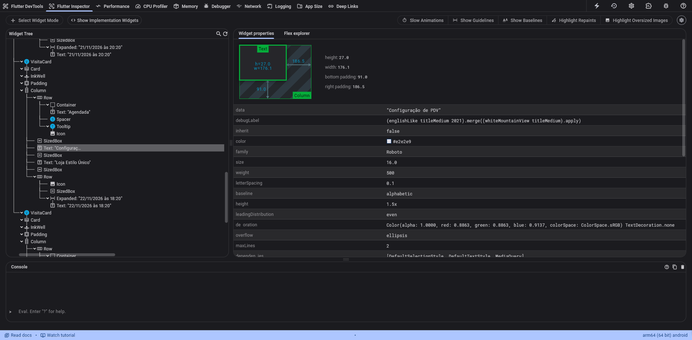
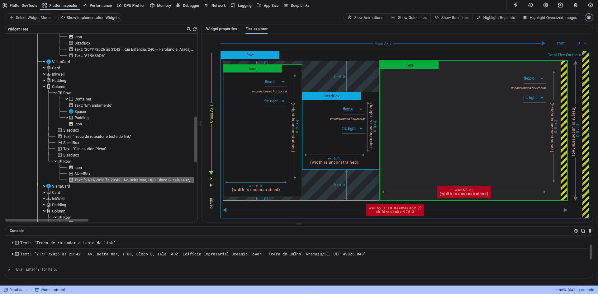
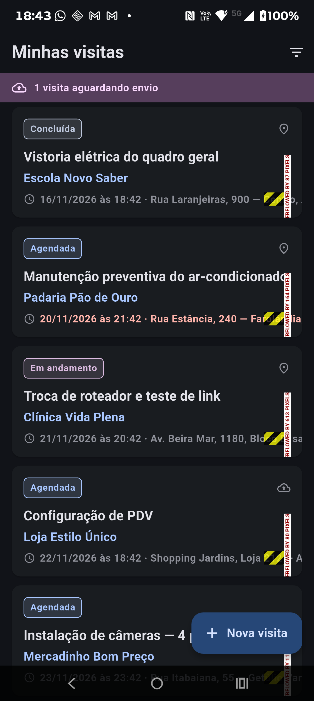

# Aula 05 — DevTools e o Ciclo de Desenvolvimento

**Aluna:** Sue Hellen Arruda da Silva (`suehellenarruda`)
**App:** fork `suehellenarruda/checkpoint-app`, rodando em debug pelo VS Code (F5) no
motorola edge 50 neo (Android 16, tela de 1200 x 2670 px, 450 dpi, **120 Hz**)

> **Situação desta entrega**
> - **Parte A**: completa, com saídas reais e prints.
> - **Partes B, C, D e E**: respondidas a partir da **leitura do código** do
>   `checkpoint-app`. As medições e os prints dessas partes **ainda não foram
>   executados** e estão marcados com ⏳. Eu não coloquei nenhum número que não
>   tenha medido. Vou completar essas partes neste mesmo PR.
>
> **Ajuste de ambiente:** o `checkpoint-app` usa Gradle 8.12, que não roda com o
> meu Java 25 (`BUILD FAILED … Java 25.0.2 … incompatible with Gradle 8.12`). Copiei a
> configuração Android do meu Checkpoint (Gradle 9.3.1, AGP 9.1.0, Kotlin 2.4.0,
> Java 17). Essa mudança fica só na minha cópia local e não faz parte da entrega.

---

## Parte A — Flutter Inspector

### A1 — Mapeando a árvore viva

Select Widget Mode ativado e cada elemento tocado no celular:

| Toque em | Widget | Ancestrais (do mais próximo ao mais distante) |
|---|---|---|
| título de um cartão | `Text("Configuração de PDV")` (`maxLines: 2`, `overflow: ellipsis`) | `Column` → `Padding` → `InkWell` (→ `Card` → `VisitaCard`) |
| faixa colorida de status | `Container` com `Text("Agendada")` dentro | `Row` → `Column` → `Padding` |
| ícone de nuvem (pendente) | `Icon` (`cloud_upload_outlined`) | `Tooltip` → `Row` → `Column` |
| FAB "Nova visita" | `FloatingActionButton` (key `fabNovaVisita`), com `Icon` + `Text("Nova visita")` | `Scaffold` → `VisitasPage` → `MaterialApp` |
| banner "aguardando envio" | `Container` (padding 16/10, largura 426,7) | `_BannerPendencias` → `Column` → `FutureBuilder<List<Visita>>` |

Observações:
- O ícone de nuvem do **banner** é outro `Icon`, que fica em `Row` → `Container` →
  `_BannerPendencias` e **não** tem `Tooltip`. Só o ícone do cartão tem `Tooltip`.
- A largura do banner, **426,7**, é a largura da tela em dp. Ela bate com a conta da
  Aula 04: 1200 / (450/160) ≈ 427.



### A2 — Provocando o overflow

**Ajuste necessário:** o `VisitaCard` do `checkpoint-app` **não exibe o endereço**.
A `Row` da linha 105 mostra só o ícone de relógio e a **data**. Remover o `Expanded`
e trocar o endereço no mock, como o enunciado pede, não faria nada transbordar.
Para o endereço longo chegar à `Row`, removi o `Expanded` **e** passei a exibir o
endereço na mesma linha da data: `'${data} · ${endereco}'`. O endereço da 2ª visita
virou um texto de **119 caracteres**. O trecho está em
[`patches/a2-sem-expanded.dart`](patches/a2-sem-expanded.dart).

**(a) Mensagem completa do console** (primeiro cartão):

```text
════════ Exception caught by rendering library ═════════════════════════════════
The following assertion was thrown during layout:
A RenderFlex overflowed by 87 pixels on the right.

The relevant error-causing widget was:
    Row Row:file:///C:/projetos/checkpoint-app/lib/ui/widgets/visita_card.dart:105:15

The overflowing RenderFlex has an orientation of Axis.horizontal.
The edge of the RenderFlex that is overflowing has been marked in the rendering with a yellow and black striped pattern. This is usually caused by the contents being too big for the RenderFlex.
Consider applying a flex factor (e.g. using an Expanded widget) to force the children of the RenderFlex to fit within the available space instead of being sized to their natural size.
This is considered an error condition because it indicates that there is content that cannot be seen. If the content is legitimately bigger than the available space, consider clipping it with a ClipRect widget before putting it in the flex, or using a scrollable container rather than a Flex, like a ListView.
The specific RenderFlex in question is: RenderFlex#4fcb7 relayoutBoundary=up17 OVERFLOWING
    constraints: BoxConstraints(0.0<=w<=362.7, 0.0<=h<=Infinity)
    size: Size(362.7, 18.0)
    direction: horizontal
    child 1: RenderSemanticsAnnotations#cfa08   size: Size(16.0, 16.0)       ← Icon
    child 2: RenderConstrainedBox#d9c7c          size: Size(6.0, 0.0)        ← SizedBox
    child 3: RenderParagraph#13876               constraints: BoxConstraints(unconstrained)
                                                 size: Size(427.9, 18.0)     ← Text
        "16/11/2026 às 18:35 · Rua Laranjeiras, 900 — Centro, Aracaju/SE"
◢◤◢◤◢◤◢◤◢◤◢◤◢◤◢◤◢◤◢◤◢◤◢◤◢◤◢◤◢◤◢◤◢◤◢◤◢◤◢◤◢◤◢◤◢◤◢◤◢◤◢◤◢◤◢◤◢◤◢◤◢◤◢◤◢◤◢◤◢◤◢◤◢◤◢◤◢◤◢◤◢◤◢◤◢◤◢◤◢◤◢◤◢◤◢◤◢◤◢◤
════════════════════════════════════════════════════════════════════════════════
```

O overflow aconteceu em **todos os cinco cartões**, porque todos agora mostram o
endereço:

| Cartão | Transbordou |
|---|---|
| Vistoria elétrica do quadro geral | 87 px |
| Manutenção preventiva do ar-condicionado | 164 px |
| **Troca de roteador e teste de link** (endereço de 119 caracteres) | **613 px** |
| Configuração de PDV | 80 px |
| Instalação de câmeras — 4 pontos | 119 px |

**A conta fecha:**
- 1º cartão: 16 (Icon) + 6 (SizedBox) + 427,9 (Text) = 449,9. Como 449,9 − 362,7 = **87,2 px**, o console mostra "87 pixels".
- Cartão longo: 16 + 6 + 953,3 = 975,3. Como 975,3 − 362,7 = **612,6 px**, o console mostra "613 pixels".

**(b) Arquivo e linha:** `lib/ui/widgets/visita_card.dart:105:15`, a `Row` da linha
de data. A mensagem aponta a `Row` que estourou, e não o `Text`.

**(c) Layout Explorer (Flex explorer) da `Row`:**



O explorer mostra a causa direto:
- **Total Flex Factor: 0**: nenhum filho é flexível;
- os três filhos estão como **`unconstrained horizontal`**;
- o `Text` mediu **w = 953,3**, o próprio tamanho natural, com o texto inteiro numa linha;
- a `Row` só tem **362,7** (`0.0<=w<=362.7`), e os filhos somam **975,3**.

Em resumo: o `Text` é o filho "rígido", ninguém limita a largura dele, e ele estoura
a `Row`.

**(d) Tela com a faixa listrada:**



### A3 — Três correções

Os trechos testados estão em [`patches/a3-tres-correcoes.dart`](patches/a3-tres-correcoes.dart).

| `Expanded` | `Flexible` | `Expanded` + `maxLines: 1` + `ellipsis` |
|---|---|---|
|  |  |  |
| sem overflow; o endereço quebra em 2–3 linhas e o cartão cresce | **igual ao `Expanded`** com estes endereços longos | uma linha só, com `…`; todos os cartões ficam com a mesma altura |

**Qual é a melhor para este caso:** o **`Expanded` + `maxLines: 1` + `ellipsis`**.
- **Com endereço longo**, `Expanded` e `Flexible` ficaram idênticos: os dois quebram o texto em até 3 linhas e deixam cada cartão de uma altura diferente. Numa lista, isso atrapalha a leitura.
- **Com endereço curto**, a diferença entre eles aparece: o `Flexible` deixa o texto mais estreito que o espaço livre e não empurra o "ATRASADA" para a direita. Mesmo assim, a altura do cartão continuaria variando com o dado.
- **Com a reticência**, o cartão tem sempre a mesma altura, curto ou longo, e o técnico toca no cartão para ver o endereço completo na tela de detalhe.

---

## Parte B — Depuração com breakpoints

### B1 — Breakpoint simples em `_salvar`
⏳ **Não executado ainda:** faltam o print `b1-variables.png` e os valores observados.

O breakpoint vai na linha 89 de `visita_form_page.dart`, a primeira linha do
`_salvar`: `if (!_formKey.currentState!.validate())`. Pela leitura do código, esperam-se
estes valores:

| Variável | Valor esperado (ao criar uma visita nova) |
|---|---|
| `_tituloCtrl.text` | o título digitado |
| `_status` | `StatusVisita.agendada` (valor inicial, se não mexer no seletor) |
| `widget.editando` | `false`, porque `visita == null` numa visita nova |
| `_agendadaPara` | agora + 1 dia, o valor inicial do `initState` |

Para as expressões, a única com resultado fixo é
`StatusVisita.values.map((s) => s.rotulo).toList()`, que deve dar
`[Agendada, Em andamento, Concluída]`. As outras dependem do que for digitado.

### B2 — Breakpoint condicional em `salvar`
⏳ **Não executado ainda:** faltam a contagem de paradas e o print `b2-call-stack.png`.

O breakpoint vai na linha 63 de `visita_repository_memoria.dart` (`await _esperar();`),
com a condição `!visita.sincronizada`. Pela leitura do código:

- **(a) Paradas esperadas:**
  - **Visita nova:** para. A `Visita(...)` criada no formulário não informa `sincronizada`, e o padrão do construtor é `false`.
  - **Mudança de status de uma visita do mock:** **não** para na primeira vez. Os mocks nascem com `sincronizada: true` (exceto "Configuração de PDV"), e o `copyWith(status: …)` da tela de detalhe mantém o `true`.
  - Então, para "criar duas visitas e alterar o status de uma existente", a expectativa é **2 paradas**, ou **3** se a visita alterada for uma das recém-criadas ou a "Configuração de PDV".
- **(b) Call Stack esperado:** quem chama `salvar` é `_VisitaFormPageState._salvar` (`visita_form_page.dart:129`, `await repo.salvar(visita)`) ou `_VisitaDetalhePageState` (`visita_detalhe_page.dart:50`). Acima deles fica o `onPressed` do botão, chamado pelo sistema de gestos do Flutter (`InkWell` → `GestureRecognizer`).
- **(c) Por que a condição acaba parando "em toda" chamada:** porque o próprio `salvar` grava `visita.copyWith(sincronizada: false)` no `Map`. Toda visita que passa pelo repositório uma vez fica marcada como pendente, e no M1 nada volta a marcá-la como `true` (o envio ao servidor só chega no M4). Por isso, depois do primeiro save, qualquer nova chamada de `salvar` com essa visita satisfaz `!visita.sincronizada`. A condição é avaliada **no parâmetro**, antes do `copyWith`. Ela só deixa de parar para os mocks que ainda não foram salvos nenhuma vez.
- **(d) Condição só para títulos com "teste":**
  ```dart
  visita.titulo.toLowerCase().contains('teste')
  ```
  O `toLowerCase()` faz a condição também pegar "Teste" e "TESTE".

### B3 — Breakpoint x `print`
Para responder ao B2(b) com `print`, eu teria que colocar pelo menos **4 linhas em
3 arquivos**:
- uma no `salvar` do repositório, para saber que ele foi chamado e com qual visita;
- uma antes do `repo.salvar` no `_salvar` do formulário;
- uma antes do `repo.salvar` na tela de detalhe;
- e ainda imprimir o `StackTrace.current` para ver quem chamou quem.

Depois seria preciso rodar de novo e, no fim, **lembrar de apagar** tudo.

**Conclusão:** o breakpoint mostra a pilha inteira, as variáveis e o estado do objeto
na hora exata, sem alterar nem recompilar o código, e permite avaliar expressões ao
vivo. O `print` só mostra o que eu já sabia que devia perguntar. Para "quem chamou
isso e com quais valores", o breakpoint é muito melhor. O `print`/`debugPrint` serve
para acompanhar um fluxo ao longo do tempo, como fiz com o `logcat` na Aula 04.

---

## Parte C — Debug x profile, medido

### C1
⏳ **Não executado no `checkpoint-app`:** faltam os prints `c1-debug.png` e `c1-profile.png`.

Fiz a mesma medição no **meu Checkpoint** (Lab 05, lista de 200 itens) e anotei os
números no README dele. Coloco aqui como referência, deixando claro que é **outro app**:

| Meu Checkpoint (Lab 05) | debug | profile |
|---|---|---|
| Quadros com jank na rolagem | ~31 em ~47 quadros | 3 |
| FPS médio | — | 119 |

Como o celular é de **120 Hz**, o orçamento por quadro é **8,3 ms**, e não 16,7 ms.

### C2 — Lista grande
⏳ **Não executado ainda:** falta o print `c2-500-itens.png`.

**Os ids e a solução:** o `copyWith` do `Visita` **não aceita `id`**, então
`visitasMock()[i % 5].copyWith(titulo: …)` geraria 500 visitas com apenas 5 ids
distintos. Como o repositório guarda tudo num `Map<String, Visita>` indexado pelo id,
sobrariam só 5. Para ter 500 de verdade, construí cada uma com `Visita(...)` copiando
os campos do modelo e gerando o id com `const Uuid().v4()`:

```dart
VisitaRepositoryMemoria(
  iniciais: List.generate(500, (i) {
    final base = visitasMock()[i % 5];
    return Visita(
      id: const Uuid().v4(),
      titulo: 'Visita numero $i',
      cliente: base.cliente,
      endereco: base.endereco,
      status: base.status,
      agendadaPara: base.agendadaPara,
      criadaEm: base.criadaEm,
      atualizadaEm: base.atualizadaEm,
      observacoes: base.observacoes,
      latitude: base.latitude,
      longitude: base.longitude,
      sincronizada: base.sincronizada,
    );
  }),
  atrasoSimulado: const Duration(milliseconds: 400),
);
```

- **(a)** ⏳ Fica para a medição.
- **(b)** O `ListView.builder` é **preguiçoso**: ele chama o `itemBuilder` só para os
  itens que estão na tela (mais uma pequena margem) e descarta os que saem. Com 500
  itens, ele constrói uns 6 ou 7 cartões por vez, não 500. Com
  `ListView(children: [...])`, os 500 `VisitaCard` seriam criados **de uma vez** antes
  do primeiro quadro: muito mais memória e um travamento na abertura da tela, que
  cresce junto com a lista. O comentário em `visitas_page.dart` diz isso.
- **(c)** Eu olharia primeiro a barra da **thread de UI**, porque ela mede o **meu
  código Dart**: `build`, layout e `setState`. Se ela estourou, o problema está em
  trabalho demais no `build`, como o laço pesado do Lab 05. Se a barra que estourou
  for a da **thread de raster**, o problema é **gráfico**: sombras, opacidade,
  recortes, imagens grandes ou compilação de shader.

  No DevTools da minha versão, as cores são **azul-claro para UI** e **azul-escuro
  para Raster**, com o jank em vermelho. Nas versões antigas, a UI era azul e a raster
  era verde. Na minha medição do Lab 05 em debug, quem estourava era quase sempre a
  barra de UI.

---

## Parte D — Caçando um vazamento de memória

### D1 e D2
⏳ **Não executado ainda:** faltam os prints `d1-vazamento.png` e `d2-com-dispose.png`.

A versão com o `dispose` comentado já está pronta para o teste: são as linhas 51 a 58 de
`visita_form_page.dart`, com todo o método comentado.

**(a) Se o Dart tem coletor de lixo, por que o `TextEditingController` não é liberado
sozinho?** O coletor só libera objetos que **ninguém mais referencia**. O
`TextEditingController` é um `ChangeNotifier`: os widgets que o usam (o `TextField` e
o `EditableText`) se registram como **ouvintes** dele, e ele guarda essas referências
numa lista. Sem o `dispose()`, essas ligações não são desfeitas e o controller passa
a representar um recurso que ninguém encerrou. O `dispose()` existe justamente para
**avisar explicitamente** que o objeto acabou: ele limpa os ouvintes e o marca como
descartado, e qualquer uso posterior passa a gerar erro em debug. Quem cria o objeto
(o `State`) é quem tem que fechá-lo. O GC não sabe quando o objeto "acabou", só sabe
se ele ainda está referenciado.

**(b) Inventário de objetos com `dispose`/`cancel` em `lib/`:**

| Arquivo | Objeto | Precisa de | É feito? |
|---|---|---|---|
| `ui/login/login_page.dart` | `_emailCtrl`, `_senhaCtrl` (`TextEditingController`) | `dispose()` | ✅ no `dispose` do `_LoginPageState` |
| `ui/visita_form/visita_form_page.dart` | `_tituloCtrl`, `_clienteCtrl`, `_enderecoCtrl`, `_obsCtrl` (`TextEditingController`) | `dispose()` | ✅ no `dispose` do `_VisitaFormPageState` |
| `data/repositories/visita_repository_memoria.dart` | `_controller` (`StreamController.broadcast`) | `close()` | ⚠️ existe o método `dispose()` que chama `_controller.close()`, mas **ninguém o chama**. O `_CheckpointAppState` (`app.dart`) cria o repositório e não tem `dispose`. Como o app vive o tempo todo, na prática isso não vaza, mas o certo seria chamar `(_repositorio as VisitaRepositoryMemoria).dispose()` no `dispose` do `_CheckpointAppState`. |
| demais arquivos | — | — | não há `Timer`, `StreamSubscription`, `AnimationController`, `FocusNode` nem `ScrollController` criados à mão em `lib/` |

**(c) Por que `super.dispose()` é a última linha?** Porque o `dispose()` da classe-mãe
(`State`) **desmonta o objeto**: ele marca o `State` como descartado e libera o que
o framework montou. A ordem certa é a **inversa da criação**: no `initState`, o
`super.initState()` vem **primeiro** (o framework monta, depois eu monto o meu); no
`dispose`, eu libero **o meu primeiro** e chamo o `super.dispose()` **por último**.
Se eu chamasse antes, meus controllers seriam descartados com o `State` já
desmontado, e qualquer coisa que ainda dependesse dele poderia falhar. Em debug, o
Flutter acusa isso.

---

## Parte E — Bônus: acessibilidade
⏳ **Não executado ainda:** faltam o print `e1-semantics.png` e o antes/depois na árvore.

Análise pelo código de `visita_card.dart`:

- **(b) Elemento interativo mal anunciado:** o **cartão inteiro** é clicável (um
  `InkWell` sem `Semantics`). O leitor de tela lê o texto junto ("Agendada,
  Manutenção…, Padaria…, 20/11…"), mas **não diz que é um botão** nem o que acontece
  ao tocar. Além disso, os ícones de **foto** e de **localização** não têm
  `semanticLabel` e **não são anunciados**.
- **(c) Ícone de nuvem:** o `Tooltip` gera um rótulo de semântica com a `message`
  ("Ainda não enviada ao servidor"), então ele **é anunciado**. Mas isso não é
  suficiente: o rótulo se mistura com o resto do cartão, e quem enxerga só vê a
  explicação com um toque longo. A informação de pendência devia aparecer também
  em texto.
- **(d) A faixa de status usa só cor?** **Não.** O código diz e faz: *"o status é
  comunicado por cor E texto, nunca só por cor"*. O `Container` tem a cor do status
  **e** o `Text(visita.status.rotulo)`. Isso importa porque uma pessoa com
  daltonismo pode não distinguir, por exemplo, a cor de "Agendada" da de "Concluída",
  mas lê a palavra. O ícone de nuvem, ao contrário, é **só ícone**, sem texto visível.
- **(e) Correção proposta** (ainda não testada no app) em
  [`patches/e5-semantics.dart`](patches/e5-semantics.dart): `semanticLabel` nos
  ícones de foto e localização, e `Semantics(button: true, hint: …)` no cartão.
